# dsh-token-plan-quota

[中文](README.md) | [English](README.en.md)

**A quota chip in the composer tool row of [DeepSeek Harness](https://github.com/deepseek-ai/deepseek-harness):
"how much is left on the vendor I am actually using".**

It exists for a specific reason: **Aliyun / Qwen Token Plan does have a quota, but no public quota API** - it is
only reachable through the console data gateway (a Cookie session), so comparable plugins generally stay away
from it. This plugin embeds that contract, and also wires up the vendors that do have official endpoints
(DeepSeek, Moonshot, OpenRouter, Aliyun BSS) as true values.

Three rules, at a glance:

| Rule | Behaviour |
|---|---|
| **Official endpoint → true value** | With a denominator: remaining bar + percentage. Without one: numbers only - a DeepSeek balance has no "total", so no bar. |
| **No official endpoint → labelled "measured"** | Only what passed through *this instance* (tokens / calls). No Credits conversion, no extrapolation, **never a bar, never a percentage**. |
| **Zero configuration** | The sources to open are decided from the provider routes you actually have; no `sources`, no `providers`. |

```
The chip in the composer tool row is a small capsule that follows the active model’s provider
(name / speed / days live in the tooltip):

  ▓▓ 75%                  the vendor publishes a denominator → bar + percentage
  123K tok  measured      no official denominator → what was used, never a bar or a percentage
```

**① The chip follows the active model's provider** — one route reports an official true value, and switching to a
route with no official quota API falls back to an explicitly labelled *measured* card:

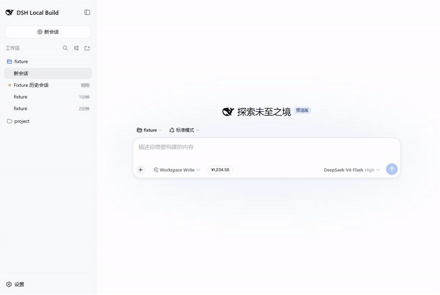

**② The detail panel**: an official quota card (a bar and a percentage only exist when the vendor publishes a
denominator) plus the multi-window meters of a single card:

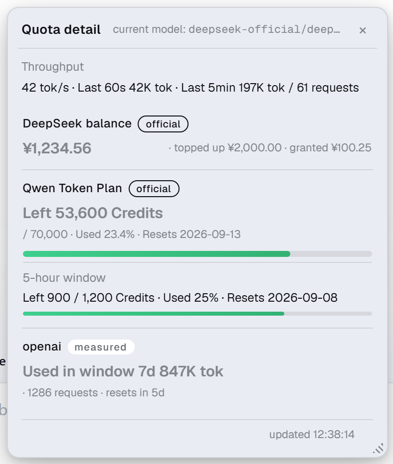

**③ The panel detached into a floating window** (drag the title bar, double-click to re-anchor):

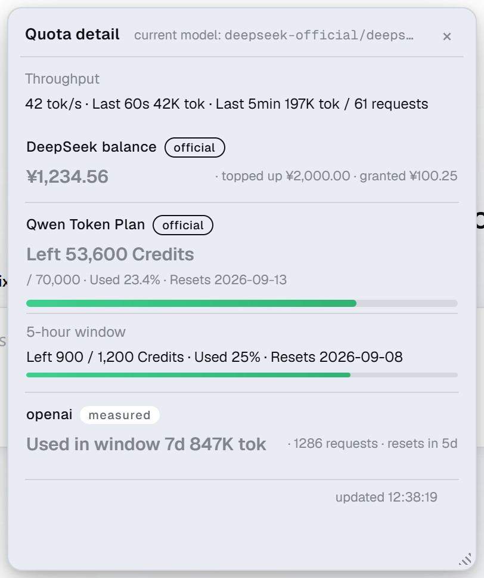

**④ The measured card taking over after the console cookie expires**: the official card becomes an error card that
states the reason and carries **no numbers at all**, while the fallback measured card stays on the chip —
no official denominator means no bar and no percentage:

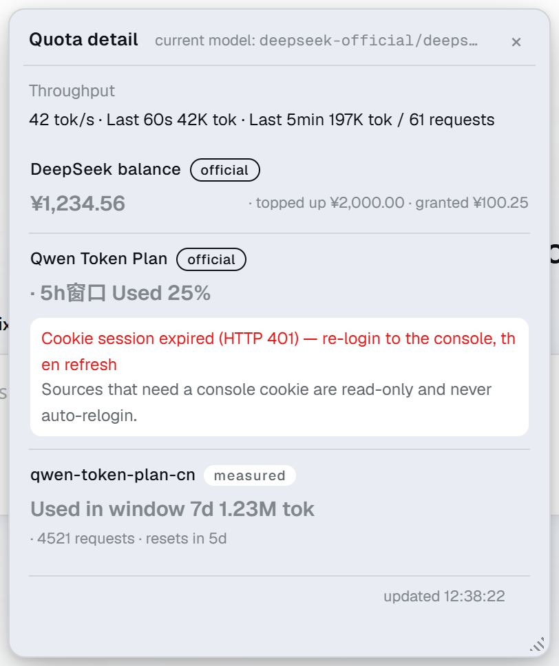

**⑤ Metered-by-balance routes are recognised too**: the DeepSeek balance is an official true value, but there is no
"total" denominator to divide by ⇒ no bar and no percentage, just the amount left, topped up and granted:

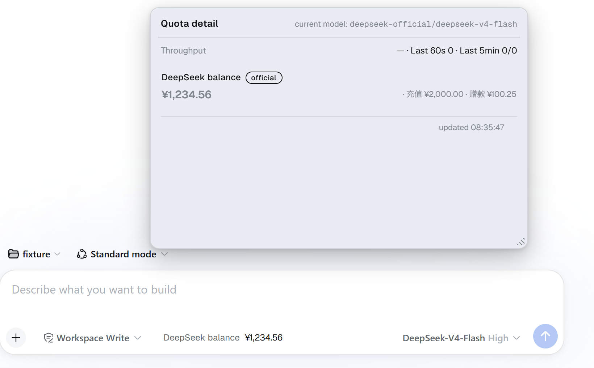

**⑥ A provider you have actually used shows its quota**: only when the official API really publishes a denominator
does the card draw a bar and state a percentage and a reset date:

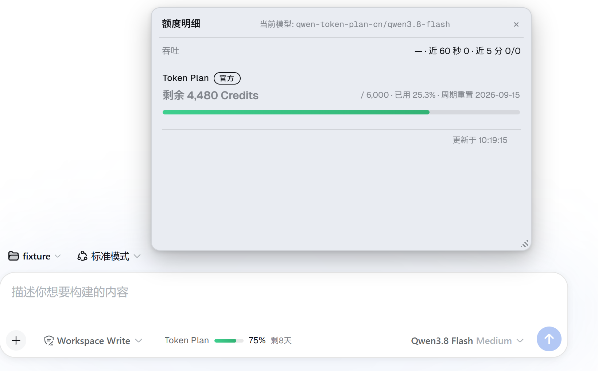

> Every balance, token count and date in those six images is **synthetic sample data**, not any real account
> (this plugin never puts real numbers into the public repo). The English set has one image fewer than the
> Chinese one on purpose: the "this instance has no calls for that provider yet" note is currently only
> emitted in Chinese by the plugin itself, and inventing an English sentence for a screenshot would put words
> in the product's mouth that it never says. Tracked in [ROADMAP.md](https://github.com/xinghe-1018/dsh-token-plan-quota/blob/main/ROADMAP.md).
> To reproduce or replace them: [scripts/shots/README.md](https://github.com/xinghe-1018/dsh-token-plan-quota/blob/main/scripts/shots/README.md).

## What this plugin does not do

This stance matters more than the feature list:

- **No Credits conversion**, no discount rates, no "remaining balance inferred from history";
- **There is no "I type in my own quota limit" window**: a denominator may only come from an official endpoint,
  so there is no key here that expresses "period + limit". `token-plan-window` is **not** a custom-window
  preset - it is the local measured ledger for Qwen Token Plan (no network, only calls that passed through
  this instance);
- **No denominator, no *derived* percentage**: nothing computed out of `used/total` or `100 - used%` is ever
  shown - a measured card never draws a bar and never shows a percentage, reporting only how many tokens / requests
  were used in its window. A percentage **the API returns itself** is official truth, though: when the plan-limit call
  times out (it does, intermittently), the chip still shows "used 3.3%", because that number came straight from
  `usage.per1MonthPercentage` - **with the bar** (it draws that same official ratio) but **without an absolute remaining amount** (what cannot be
  computed is not displayed), and with an `extra.denominatorFailed` diagnostic instead of going silent;
- **Plan configuration is not your quota**: a window exists only when that plan actually reports a reading
  (a `five_hour` cap sitting in `quota-config` does not mean your account has a 5-hour window);
- **Never guess**: detection would rather show one card fewer than pin another vendor's balance to the model
  you are using;
- **No probing that costs money** - read-only endpoints only;
- **No reading other CLIs' local login state** (see [Three credential shapes we will not implement](#three-credential-shapes-we-will-not-implement)).

## Install

```bash
dsh plugin --profile web add dsh-token-plan-quota          # npm package name
dsh plugin --profile web add github:xinghe-1018/dsh-token-plan-quota
dsh plugin --profile web add ./dsh-token-plan-quota        # local directory
```

`dsh plugin` passes through to pnpm inside the profile directory. This plugin has **zero third-party
dependencies and no build step**, so it never trips pnpm ≥10's build-script allowlist.
**Restart `dsh web` once** after installing (bundles and client entries are assembled at startup).

The only external resource at runtime is three CDN font links; if they fail, the UI falls back to system fonts.

## Supported vendors

| Vendor | Quota source | What the chip shows | Verification status |
|---|---|---|---|
| DeepSeek | ✅ official `/user/balance` (Bearer) | balance + topped-up + granted (truth) | verified with a real key |
| Qwen Token Plan | ⚠️ console data gateway (**cookie session**, not a published API) | used % + progress bar (same source as the subscription page); falls back to the measured card when the cookie is missing/expired | verified with a real account |
| Moonshot / Kimi open platform | ✅ official `/v1/users/me/balance` (Bearer; `.cn` CNY / `.ai` USD) | balance + cash + voucher (truth) | endpoint existence probed; **field names not yet checked against a real key** |
| OpenRouter | ✅ official `/api/v1/credits` (Bearer) | balance (USD) = total credits − total usage | endpoint existence probed; **field names not yet checked against a real key** |
| Aliyun BSS | ✅ BssOpenApi (AK/SK signature) | account balance / resource packs (truth) | every field checked against official OpenAPI metadata |
| MiniMax, OpenAI/Gemini with a plain API key, … | ❌ no key-authenticated quota endpoint | **measured** card (tokens / requests only) | common paths probed; no endpoint exists |

Per-vendor endpoints, envelope fields, unit traps and percentage direction are documented in
[`docs/upstream-contracts.md`](docs/upstream-contracts.md).

**API hosts only, never console domains**: web console domains such as `platform.kimi.com`,
`platform.moonshot.cn` and `bailian.console.aliyun.com` take no part in detection - the plugin queries balance
APIs, which live on the API host the route's `baseURL` points at (`api.moonshot.cn` / `api.moonshot.ai`).
A Kimi open-platform key belongs to the same account and balance as a Moonshot one, so point the route at
`api.moonshot.*`; if your `baseURL` says something else, detection will not recognise it and you get the
measured card instead. To force the official card, do not just name the source - **bind it to your real route
id**, or under the default `panelScope: "current"` it is queried but never displayed (the preset carries generic
names like `moonshot`, which do not include your route):

```json
{ "sources": [{ "id": "moonshot-balance", "providers": ["kimi-open-cn"] }] }
```

Mind the last column of the table above: this vendor's field names are not yet checked against a real key, so if
the forced card looks wrong, compare field names with `probe`. When a `providers` list binds to nothing at all,
the host logs a warning - you are not left guessing in front of an empty panel.

### How this differs from neighbouring plugins

The ecosystem already has related plugins, mostly in the **cost-tracking / spend-estimation** direction
(`dsh-cost-meter`, `dsh-token-monitor`). This plugin does not compete there: its stance is **only official truth
or explicitly-labelled measurement, never conversions or estimates**, the chip **follows the current model's
provider**, and it ships the **Aliyun / Qwen Token Plan console-quota contract** - a vendor that has a quota but
no public API, which is precisely why this plugin exists. Want a cost dashboard? Take the former. Want "how much
is left on the provider I am using right now"? Take this one.

## Architecture at a glance

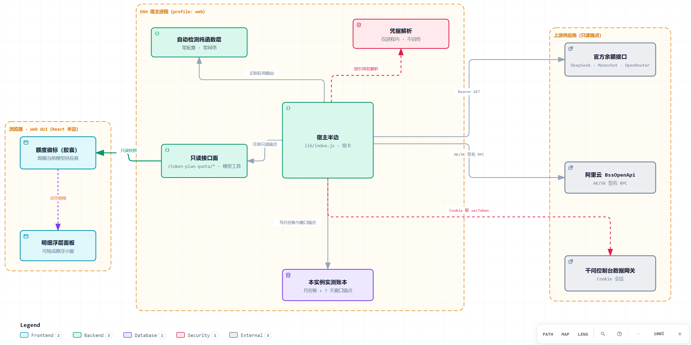

One picture of how the halves divide the work: the **browser half** (`lib/client.js`) renders the chip in
the input tool row that follows the current model and opens into the detail panel; the **host half**
(`lib/index.js`) wraps `llm/stream` to keep this instance's ledger, registers the read-only routes and the
`token_plan_quota` tool, and queries upstream along the routes zero-configuration detection found;
**upstream** splits by whether an official endpoint exists - official truth where there is one
(DeepSeek / Moonshot / OpenRouter / Aliyun Billing), and the Qwen Token Plan console data gateway
(cookie session) where there is not. Credentials only go in: Bearer / AK-SK / cookie are resolved inside
the host process, and neither the read-only routes nor the model tool ever send them back.

The diagram is generated, not hand-drawn: its source spec lives in the repository's `diagrams/`, and
[`diagrams/README.md`](https://github.com/xinghe-1018/dsh-token-plan-quota/blob/main/diagrams/README.md)
covers regeneration and prerequisites (that directory does not ship with the npm package).

## Zero-configuration detection

The provider routes live in your harness are the **single source of truth** for which sources to open, so you
never write `sources` and never hand-fill `providers` - historically those two lists drifting apart is exactly
what produced "the card is queried but never displayed". Matching runs in confidence order, first hit wins:

| Signal | Notes |
|---|---|
| `baseURL` host | Most trustworthy - where the route actually points. `api.moonshot.cn` → Moonshot mainland region, `openrouter.ai` → OpenRouter, the Token Plan gateway → Qwen |
| route id / display name | Used **only when no host is available** (the shipped `deepseek-official` route relies on this) |
| key prefix | Last resort (`sk-or-` → OpenRouter) |
| nothing matched | Attach a `window:<provider>` measured source **per unmatched route** (three unrecognised routes, three cards): the chip stays visible, reporting local tokens/requests only |

**In this document `provider`, "route id" and the strings inside `providers` are the same thing**: the `id`
returned by the host's `llm.listProviders()` (compared case-insensitively, with `.` `_` `/` all treated as `-`).
So the `window:minimax-cn` card only appears for the model on route `minimax-cn`, and the fallback detection
attaches is called exactly the same (`window:minimax-cn`) - one card, two spellings.

Two invariants:

- **Your configuration always wins - as a layer, not as a replacement.** With `autoDetect: true` (the default)
  what you write lands first and detection then fills in **the parts you said nothing about**; adding one entry
  never wipes the cards it did not mention. "Already covered" has exactly three meanings:
  (1) one of your sources lists this route id in `providers` → detection adds nothing to that route;
  (2) you have a source with the same `id` → detection will not open a second one (`skipped` records
  `id-taken-by-configured`); (3) you wrote `{"id":"<source>","enabled":false}` → that name is never opened
  automatically again (`skipped` records `disabled-by-config`). A fourth case is not a coverage rule at all: a
  source whose credential cannot be resolved is simply not opened (`skipped` records `no-credential` and lists the
  reference names it tried; no error card taking up space). Only `autoDetect: false` makes your list the
  single source of truth.
- **Explainable.** Every auto-opened card carries `detected: {by, rule, host, fallback}`; its tooltip says
  "identified from api.moonshot.ai · region international", and the snapshot's `detection` block lists live
  routes, what was opened, what was skipped and why, and which routes were not recognised - one place to
  answer "why is this provider missing" (**it is only in the `GET /token-plan-quota/summary` payload; the panel
  does not render it**). On an older host without an `llm` service, detection degrades
  silently to the configured sources.

## Interface

- **The chip follows the model**: it subscribes to the host's existing `sessions.list` → `modelDirectories`
  runtime stores, so switching models updates the card immediately - no polling, no extra network.
  Priority: an official card with numbers > a measured card with numbers > an errored official card
  (which tells you to configure the cookie).
- **One quota card per provider**: when the official card has numbers, the auto-attached measured fallback card
  is hidden; when the official card turns into an error card, the fallback must come back. This decision lives
  in the display layer where the data is visible - deciding it at planning time left a blank badge the moment
  a cookie expired.
- **A card can carry several windows**: the host orders them into `card.meters` (**this is the card shape in the
  snapshot, not a key you can write in a source entry**); `meters[0]` is the same source
  as the top-level value (shown by the headline and the main bar), and each further window gets its own row -
  "label · remaining/total · used% · resets" - with its own thin gradient bar.
- **The detail panel is a persistent window**: drag it by the title bar, resize with the bottom-right handle,
  position and size persist in `localStorage`, double-click the title to re-anchor.
  **Clicking anywhere else never closes it** - only the `✕` in the title bar, clicking the chip again, or `Esc`.
  Dismiss-on-outside-click is dropdown semantics that conflicts with this, and identifying the host's input
  area via selectors is guaranteed to leak (the shipped web bundle does not even contain
  `data-composer-card`).
- Visuals: a ghost control with no border, no status dot and no emoji - **the gradient balance bar is the
  status** (≥70% green, 40-70% blue, <40% orange→red); "official / measured" pills mark the tier; its own font
  stack (Geist Variable + Noto Sans SC, system fallback offline) with monospace reserved for identifiers;
  every animation respects `prefers-reduced-motion`.
- `panelScope: current` (default) lists only the current provider's cards; set `"all"` to see every source.
- **"Measured" has exactly one meaning in this document**: a number computed from the local ledger, never an
  official balance. It appears in three places - the "this instance, measured" block in the panel (that is what
  `showInstanceWindow` toggles), the `window:<provider>` card for any vendor, and the built-in
  `token-plan-window` (which simply *is* the Qwen ledger). All three default to a 7-day window, changeable with
  `windowDays`; the window is anchored at this instance's first call, and "reset this cycle" re-anchors it.

## Usage statistics (measured in this instance)

The **Usage statistics** button at the bottom of the chip window opens a **full-page view** - it replaces the
conversation main area and keeps the sidebar; `Esc` or the `✕` in the title row takes you back:

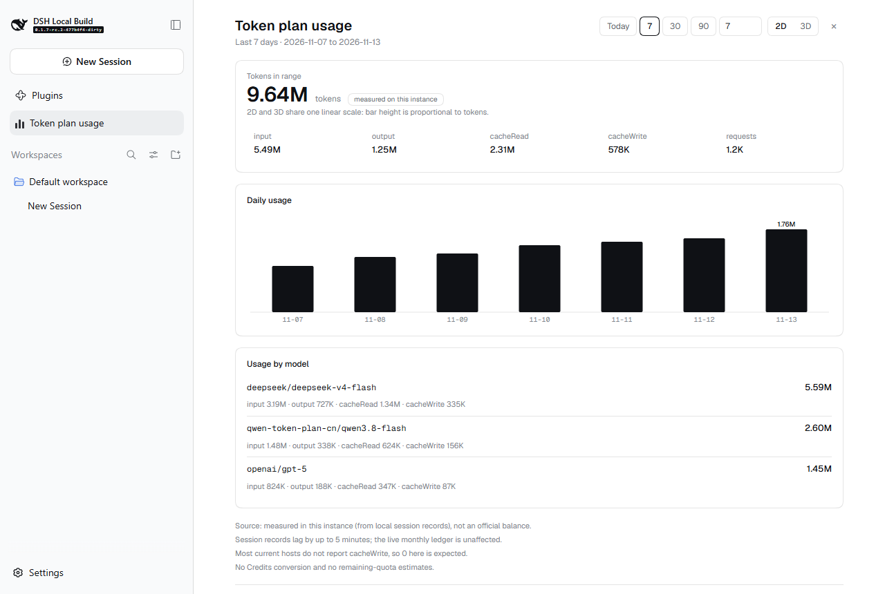

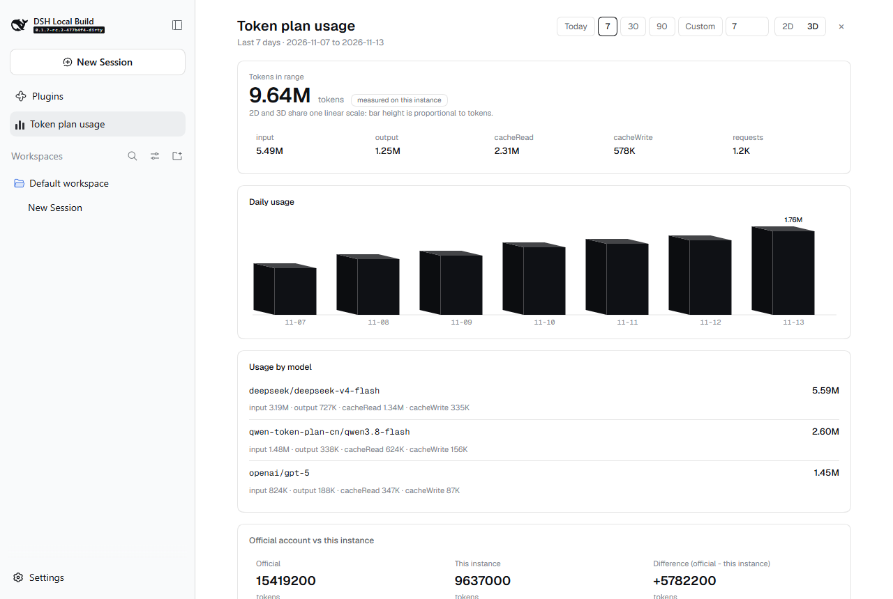

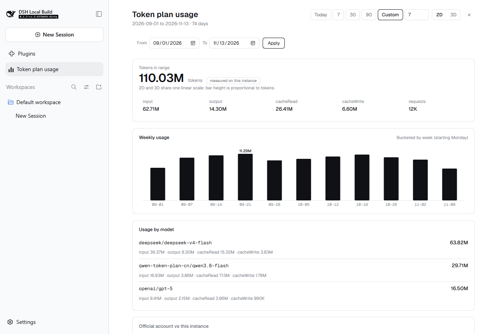

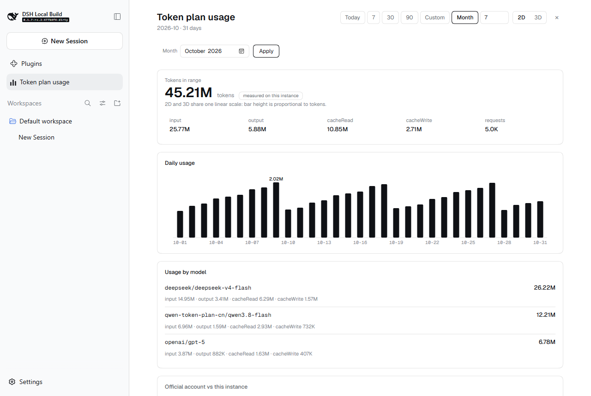

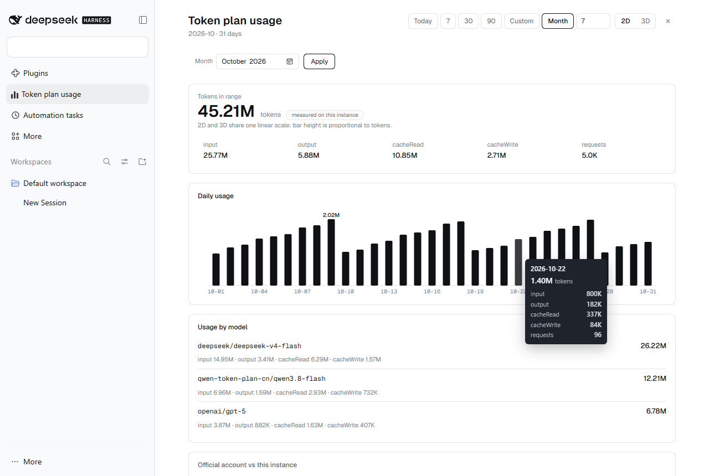

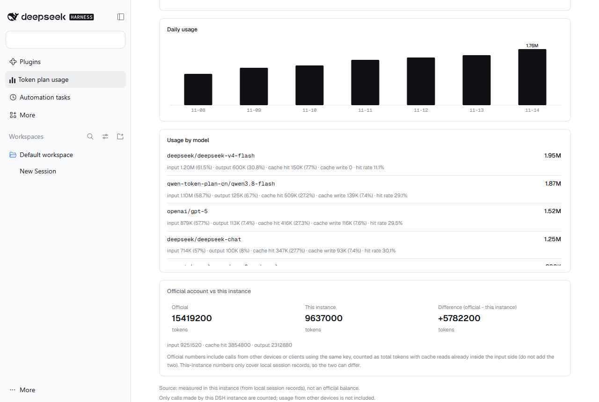

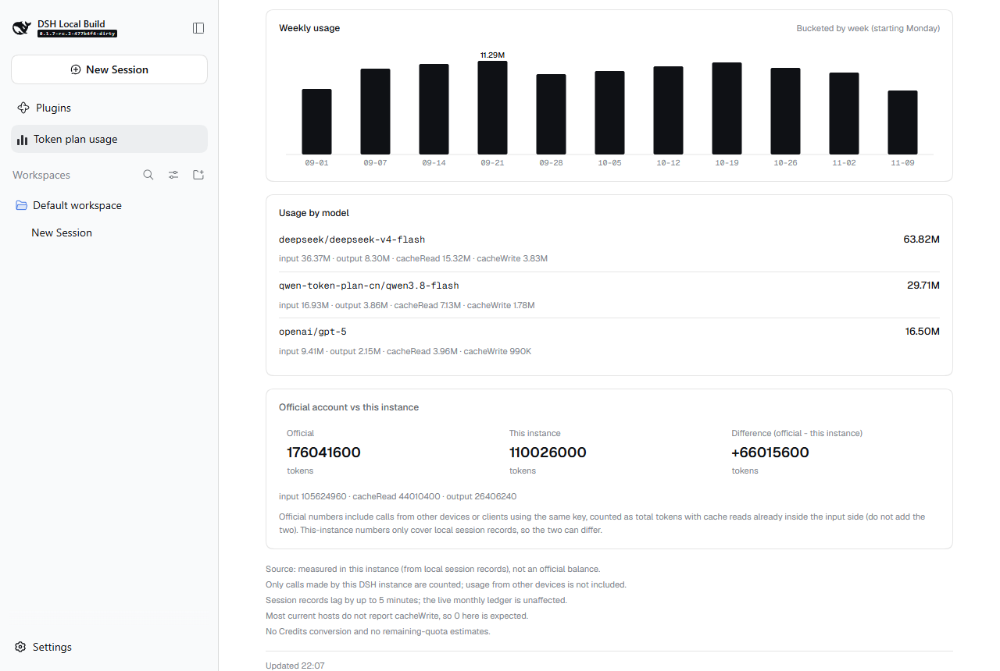

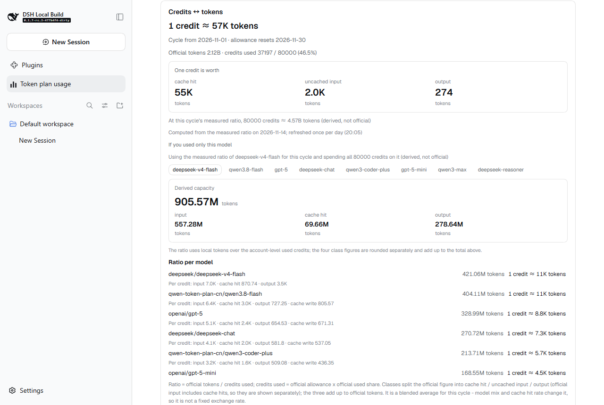

- **Absolute tokens only**: the range total, the four buckets (input / output / cache hit / cache write), the
  call count and a per-model ranking. This screen answers "how much have I used lately", not "how much is left" -
  so there is no quota percentage and no Credits.
- **Composition at a glance**: besides the four absolute values, the total card shows each bucket's **share of the
  range total** and the **cache hit rate** (cache hit ÷ (input + cache hit + cache write), one decimal; `—` when
  the denominator is 0). Every model row carries the same four shares plus its hit rate. These describe usage
  composition, not remaining quota and certainly not a quota ratio; the footnote spells out both formulas and
  says so.
- The data comes from the **host's own session events** (`sessionPersistence`), folded offline into a
  per-local-day index: the first run walks the existing sessions (measured here: 217 session directories, ~200 MB of
  logs, ~20 s to decode and fold), after which it syncs incrementally every 5 minutes, so the numbers are at most
  5 minutes old.
  This is not the same thing as the measured **window** in the detail panel (7 days from the first call): that is
  a window, this is day-by-day history.
- Range selection: four presets (today / 7 / 30 / 90 days) plus a custom 1..365 input (out-of-range values are
  clamped and written back). **Above 62 days the buckets become weekly** (local Monday boundaries, first and last
  buckets may be short) - 365 daily bars neither fit nor read.
- You can also query an **explicit date range**: "Custom" next to the presets opens two date boxes, and picking
  Sep 1 to Sep 30 shows exactly those 30 days (both ends inclusive). Invalid input (empty, malformed, start after
  end, start in the future) is blocked **locally, without sending a request**; the span limit is the same
  `usageBackfillDays` key that bounds index retention (365 by default), an end date after today is clamped
  to today, and the range shown on screen always uses the **clamped** value. Above 62 days it still aggregates
  weekly, but the **first and last buckets hug the selected range** - no padding out to whole weeks.
- You can also query a **calendar month**: "Month" next to the presets opens a month box, and picking 2026-10 shows
  only that month (the 1st to the last day, one bar per day). The current month stops at **today** (the end date is
  clamped and the screen shows the real value); a malformed month or a future month is blocked locally without a
  request. `month` cannot be combined with `from`/`to` (400 `usage-bad-range`); a bad or future month returns 400 `usage-bad-month`.
- **Official account-side comparison** (opt-in via `officialUsage`): a strip under the bars puts the
  **official "Token Plan usage details"** (account-level tokens) next to this instance's measurement, with
  the difference (official − local) as the third cell. The official side counts the same key used by other
  devices and clients, so the difference is what was spent outside this machine; a negative difference is not
  a bug - it means the official series does not cover everything here (settlement lag, or it only counts calls
  made with the Token Plan key). Both cells count tokens the same way: a cache hit counts once on each side
  (the official side folds it into `input`, `total = input + output`), so the two numbers subtract directly.
  Still absolute tokens only: no percentages, no Credits. The official API only
  goes back to the first day of the month five months ago, so earlier ranges are clamped and the screen says
  **which start was clamped away**; long ranges are split into 30-day chunks and re-joined (the gateway's real
  limit). When it cannot be
  fetched (no cookie / expired session / upstream failure) the cell shows **only an actionable message and no
  numbers at all** - "unavailable" is never drawn as 0.
- **Credits ↔ tokens conversion** (needs the console source to be readable): the console exposes Credits only as
  "allowance × used share", so this block divides it by the **official account-level tokens** of the same cycle and
  shows the measured ratio `1 credit ≈ N tokens`, with the official tokens, credits used / allowance and the official
  used share side by side so the ratio can be checked. Credits used = official allowance × official used share, and the
  numerator is always the official account-level number (it includes other devices) - **never this instance's tokens**,
  because mixing the two calibers understates the ratio. The cycle is the current monthly meter (falling back to the
  7-day window) and is **independent of the range selector above**: Credits only have one reading per cycle, and
  splitting them across a range would be an estimate. It is a **blended average for this cycle** - model mix and cache
  hit rate change it - so the footnote says outright that it is **not a fixed exchange rate**, and the "allowance in
  tokens" line is marked as derived, not official. When the official detail is clamped to a later start, or the
  allowance, reset time or a monthly/weekly meter is missing, the block shows **no ratio** and says why; it never
  borrows a partial range or this instance's numbers.
- **Per-class ratios and a per-model ratio**: two more layers inside the same block. Classes use the official caliber
  only - the official tokens are split into cache hit / uncached input / output, each with its own tokens-per-credit
  (official input **includes** cache hits, so they are subtracted and shown separately; the three add up to the official
  tokens - treating official input as "uncached input" would overflow the total). The **Per-model ratio** =
  local tokens for that model / credits used this cycle, which is a **contribution** figure: official data is not split
  by model and no per-model price is published, and splitting credits by token share would make every row equal the
  overall ratio (false precision). The footnote therefore states that official data is not split by model and that rows
  sum to roughly the local total, which differs slightly from the official account total. When classes or model rows are
  missing, only that part is skipped - never a 0, never a dash.
- 2D and 3D share **one linear scale function**: 3D only draws the same bar as an isometric SVG with three faces
  (top / front / side), fixed angle, no perspective and no foreshortening, so switching the view cannot make a bar
  look taller than its number.
- **Hover any bar** to see that bucket's detail: the date (weekly buckets read `start – end`) and the bucket's
  total tokens, then the four buckets and the call count. Works in both 2D and 3D; touch tap and keyboard
  `Tab` focus open it too (`Esc`, clicking elsewhere or scrolling close it). The tooltip reports absolute
  tokens only - no derived percentages, no Credits.
- **The model ranking scrolls inside its card**: the list is capped at about four rows and a thin scrollbar
  reveals the rest; the container itself is `Tab`-focusable so keyboard and screen-reader users can scroll it.
  No amount of models can push the official comparison or the footnote off screen.
- **The screen scrolls as one page**: the whole panel sits in a scroll viewport (`data-usage-scroll="1"`, thin
  scrollbar, `Tab`-focusable, `PageDown` / `End` work), so content taller than the host's main seat is no longer
  clipped; the model ranking keeps its own in-card scroll and the two scroll independently.
- **Model names come from the session header**: when a later slice carries no new header, the last declared
  `provider/model` of that session is reused, so usage no longer falls into "unknown" mid-session. Sessions whose
  logs never declare a header are still reported as unknown - we do not guess.
- When the data is not available it says so: no `sessionPersistence` → falls back to "since this process started"
  (resets on restart); backfill still running → a thin progress bar and "backfilling (N/M sessions)"; statistics
  turned off → the screen states that, instead of pretending "cannot measure" means zero.
- **No need to chat before opening the screen after a restart**: the index is loaded from disk synchronously on the
  first query. It used to wait for the first sync 20 s after boot, so opening the stats screen right after a restart
  (with no turn in between) showed zeros until you sent a message to kick the sync.
- **Sessions missing from the host list are recovered by scanning**: the host's session list occasionally omits a
  session (measured here: 2 of 217 session directories were missing from it, about 65M tokens that were never
  counted). At the end of each sync the plugin reads those logs straight from the `$DSH_HOME/sessions` layout:
  highest-version log file only, a signature of file size plus mtime (skip when unchanged), at most 64 MB per round
  (the rest continues next round), and forked sessions are truncated at the inherited-prefix marker so the parent's
  calls are not counted twice. The count of recovered sessions is stated in the screen footnote.

The index is persisted at `$DSH_HOME/token-plan-quota.usage-index.json` and holds counters plus `provider/model`
identifiers only - **no message text, no request headers, no file paths**. A corrupt file is backed up as
`.bad-<milliseconds>` and rebuilt rather than losing the whole chart.
## Configuration

Main config lives in `~/.dsh/token-plan-quota.json` - the host re-reads it before every query, so **changes
apply without a restart** (it can also go in the bundle row's `config`; the JSON wins):

```json
{
  "autoDetect": true,
  "refreshMinutes": 10,
  "pollSeconds": 10,
  "panelScope": "current",
  "debug": false
}
```

The table below has 26 rows: 25 are keys of `DEFAULTS` in the code, and `moonshotRegion` is the exception - it is
not in `DEFAULTS` but is read by the Moonshot source through `regionConfigKey`. **One key per row, and the unit is
part of every name** (`Minutes` / `Seconds` / `Ms`).

| Key | Default | Meaning |
|---|---|---|
| `autoDetect` | `true` | Fill in sources from the host's live provider routes. **Writing `sources` does not switch it off**: your entries are one extra layer and detection still covers the routes you said nothing about, so `"sources": []` merely means "I have no additional request" (identical to omitting it). Set `false` to make your list the single source of truth: with nothing written you get the two built-ins `deepseek-balance` + `token-plan-window`, and with `"sources": []` you get **no cards at all** |
| `sources` | none (detection decides) | Ordered source list. Built-in names (8): `deepseek-balance` (DeepSeek balance), `token-plan-console` (Qwen console quota, cookie), `token-plan-window` (**Qwen local ledger** - not a custom window), `moonshot-balance` (Moonshot/Kimi balance), `openrouter-credits` (OpenRouter balance), `account-balance` (Aliyun account balance), `fr-instances` (Aliyun resource-pack instances), `resource-package` (Aliyun resource-package allowances); or the `window:<provider>` shorthand (a measured window for any vendor); or a custom object (see [Custom sources](#custom-sources)) |
| `moonshotRegion` | `china-mainland` | `china-mainland` (`api.moonshot.cn`, CNY) or `international` (`api.moonshot.ai`, USD). **Keys do not work across regions**; a wrong region returns 401 and the card tells you to switch. Host and currency switch as a pair - there is no auto-probing |
| `refreshMinutes` | `10` | Cache TTL for official sources in minutes: TTL = minutes × 60 s, **floor 15 s**, so `"refreshMinutes": 3` means one upstream call per 3 minutes (sub-minute polling is not what this key is for - see `pollSeconds`). The panel's "updated" line or `?fresh=1` forces a refetch |
| `pollSeconds` | `10` | Front-end poll interval - how often the UI re-reads the snapshot. Measured values and throughput are recomputed live anyway; lowering this never adds upstream calls |
| `panelScope` | `current` | `current` lists **only cards whose `providers` include the active route id**, plus this instance's usage; `all` lists every source. That means the three Aliyun sources are **invisible under `current`** - an account balance and its resource packs have no provider binding, so they never enter a route-filtered view; set `"all"` to see them |
| `showInstanceWindow` | `true` | Include the "this instance, measured + retry observations" block in the panel. It is **not** a data-source switch and does not affect `window:<provider>` cards |
| `exposeTool` | `true` | Register the `token_plan_quota` model tool |
| `debug` | `false` | Permanently echo the upstream response's **field skeleton** (values masked, credential-like keys skipped) in the panel. Same output as `GET /token-plan-quota/probe?source=<id>`; the difference is that debug is always on while probe is one-off and needs no config change |
| `endpoint` | `business.aliyuncs.com` | Aliyun BSS sources only: OpenAPI endpoint (change it for the international site). A leading `https://` and trailing slashes are stripped |
| `allowUndeclaredHosts` | `false` | User-side switch for the outbound allowlist: by default only the 8 hosts declared in `dshhub.permissions.network` are reachable (loopback excepted) - anything else is refused before the request goes out (`HostNotDeclared`). A custom source pointing elsewhere must opt in explicitly; when it is on, the snapshot carries a notice so nothing degrades silently. A built-in source reporting this means code and declaration drifted, so `DECLARED_HOSTS` in `lib/index.js` and `package.json` must be changed together |
| `regionId` | none | Aliyun only: the OpenAPI `RegionId` |
| `accessKeyIdRef` | `ALIBABA_CLOUD_ACCESS_KEY_ID` | Aliyun only: credential reference name for the AccessKeyId |
| `accessKeySecretRef` | `ALIBABA_CLOUD_ACCESS_KEY_SECRET` | Aliyun only: credential reference name for the AccessKeySecret |
| `securityTokenRef` | none | Aliyun only: credential reference name for an STS token (leave empty with long-lived AK/SK) |
| `configPath` | `$DSH_HOME/token-plan-quota.json` | Where the external JSON config lives (`~/` = OS home, `$DSH_HOME/` = harness home) |
| `usagePath` | `$DSH_HOME/token-plan-quota.usage.json` | Where the local ledger is persisted (current month and window anchors) |
| `usageStats` | `true` | Enables usage statistics (session events folded into a per-local-day token history). Off = no sync and no in-memory counting; the **entry point stays**, and the screen states that it is disabled and which key turns it on - existing index data is kept, and the quota sources above are unaffected |
| `usageIndexPath` | `$DSH_HOME/token-plan-quota.usage-index.json` | Where the usage index lives. This is a **different file** from the `usagePath` ledger: one is day-by-day history (this screen), the other is the current month plus window anchors (the measured block in the detail panel) |
| `usageBackfillDays` | `365` | How many days the index keeps, and the upper bound of the screen's range picker (1..365). Lowering it trims older day buckets; raising it backfills on the next sync |
| `officialUsage` | `true` | Whether the usage screen shows the "official account side" strip: the console gateway's Token Plan usage details (account-level tokens, unrelated to the quota sources above). Off = that request is not made; bars and local numbers stay as they are |
| `officialUsageMinutes` | `5` | Cache minutes for the official strip: the same range is reused for N minutes (`0` = always refetch) |
| `usageScanFallback` | `true` | Whether the end of each sync also scans `usageScanPath` for session logs the host list does not mention. Off = trust the host list only (and keep missing the sessions it hides) |
| `usageScanPath` | `$DSH_HOME/sessions` | Root directory of the fallback scan (two levels: project directory / session directory / log file) |
| `minIntervalMs` | `1200` | Minimum interval between outbound calls (ms), throttling globally |
| `timeoutMs` | `15000` | Per-request upstream timeout (ms, floor 1000) |

### Turning one single card off

An item of `sources` may be a built-in name (a string) or an object - **options only attach to the object form**,
so to switch one card off, turn that item into an object. **This is an exclusion, not a replacement of the whole
list**: leave `autoDetect` at `true` and every other card is still filled in.

```json
{
  "autoDetect": true,
  "sources": [
    { "id": "deepseek-balance", "enabled": false },
    { "id": "fr-instances", "enabled": false }
  ]
}
```

- **It works on sources that detection opened too**: with `{"id":"moonshot-balance","enabled":false}` written,
  detection will not add that card back, and the `skipped` list keeps a `disabled-by-config` entry - so
  "not recognised" and "you switched it off" stay distinguishable.
- **It switches off this source, not this vendor** - but what is left for that vendor depends on whether it is in
  the rule table, and that has to be spelled out:
  - **Recognised vendors** (DeepSeek / Moonshot / OpenRouter) have exactly one official source each, so switching
    it off leaves **no card**: the measured fallback is only attached to routes detection could *not* recognise.
  - **Qwen is the exception**: it carries both `token-plan-console` (official) and `token-plan-window`
    (measured), so switching the first off leaves the second in place.
  - **Unrecognised vendors** (MiniMax and friends) already have only a `window:<provider>` card; to drop that,
    name it: `{"id":"window:minimax-cn","enabled":false}` (`<provider>` is the route id - see the section above).
- Prefer a clean sweep? Set `autoDetect: false` and write the whole list yourself. Either way,
  **what you wrote always wins**.

### Credentials

Resolved in order: **DSH credentials service → environment → `~/.dsh/.credentials.yaml` → `~/.dsh/.env`**,
re-resolved on every query, so swapping a key needs no restart.

| Source | Reference name |
|---|---|
| DeepSeek | `DEEPSEEK_API_KEY` |
| Moonshot | `MOONSHOT_API_KEY` (must match the region; detection prefers the name the route's own profile declares, e.g. `MOONSHOT_CN_API_KEY`) |
| OpenRouter | `OPENROUTER_API_KEY` (`sk-or-v1-…`) |
| Qwen Token Plan quota | `BAILIAN_CONSOLE_COOKIE` (+ optional `BAILIAN_CONSOLE_SECTOKEN` as an override) |
| Aliyun | `ALIBABA_CLOUD_ACCESS_KEY_ID` / `ALIBABA_CLOUD_ACCESS_KEY_SECRET` |

Reference names can be overridden per source with `bearerRef` / `cookieRef`.

To see the **real** Qwen Token Plan quota (the "76.2% left / 10,000 total" from the subscription page):
sign in and open the [subscription page](https://platform-home.qianwenai.com/analytics/token-plan/individual) →
press F5 → F12 → Network (tick **Preserve log**) → filter by `cs-data` → copy the **entire `Cookie:` request header line**
of the **`cs-data.qianwenai.com/data/api.json`** request (`action=BroadScopeAspnGateway`) → store it as one line
`BAILIAN_CONSOLE_COOKIE: <content>` → click "updated" in the panel to refresh.
Three hard requirements - miss any one and this card errors, and **the error code says which one**:

- **It must come from the host the plugin actually calls** (`cs-data.qianwenai.com`). Cookies are domain-scoped, so one
  copied from another console domain will not work (seen twice in the field in 2026-10: filtering by the old hint's
  `bailian-cs` matched no request at all, and cookies taken from the Aliyun side - `cna/cnaui/... + login_aliyunid_csrf` -
  were rejected just the same). → `BailianGateway.Login.NotLogined`, and the message names the missing ticket.
- **It must contain the login ticket `login_qianwenai_ticket`.** Anti-bot cookies alone (`cna`, `cnaui`, `aui`, `sca`,
  `atpsida`, `tfstk`, `isg`, `partitioned_cookie_flag`) mean you copied a request that carries no login state. Same code.
- **A `sec_token` must be attachable.** The plugin fetches it automatically from
  `platform-home.qianwenai.com/tool/user/info.json` with that same cookie; when it cannot get one the source reports
  **`MissingSecToken`** with the reason (`no-token` / `http-<status>` / `network:<error>`). **This is not a mis-copied
  cookie**: refresh once, or store the response's `secToken` as `BAILIAN_CONSOLE_SECTOKEN`. When the reason is
  `no-token` the message also carries the response's **key skeleton** (names and types only - never values), which is
  how you tell whether the token was renamed, moved a level deeper, or simply never issued for this session. Field case 2026-11-03: the
  ticket was plainly there while the old wording kept asserting "probably a cookie from another host", so re-pasting
  the cookie could never fix it.

When both the ticket and the `sec_token` are in place and the gateway still refuses, the only cause left is an
**expired session** (cookies usually last a few weeks): sign in again and re-copy on the spot. On rejection the panel
error **lists the cookie names received and the host the plugin calls**, so you can see at a glance which step went
wrong; the measured card takes over meanwhile.

### Custom sources

When a vendor publishes a new endpoint, or you want to wire in a console API yourself, you do not need to wait
for this plugin. `kind: "single"` with `fields`/`derive` covers the "balance is a difference" shape:

```json
{
  "sources": [{
    "id": "my-balance", "label": "My balance", "kind": "single", "metric": "money",
    "url": "https://example.com/api/account", "method": "GET", "bearerRef": "MY_API_KEY",
    "unit": "USD",
    "fields": { "credits": ["data.total_credits", "total_credits"], "usage": ["data.total_usage", "total_usage"] },
    "derive": { "total": "credits", "used": "usage", "remaining": "credits - usage" },
    "providers": ["my-provider"]
  }]
}
```

`derive` accepts exactly one `+`/`-` with a field reference or a number on each side, and **returns nothing if
either side is missing** - it never invents a number. Multiply, divide or parenthesised expressions mean you
should write a dedicated builder instead. The slot names in `fields` are yours to choose (`credits`/`usage` above
are just names - they are also the variables `derive` can reference), and giving each slot several candidate paths
is deliberate: the same API has shipped with and without a `data` envelope.

#### Every key a hand-written entry accepts

**An unrecognised key raises no error and does nothing** (entries are merged verbatim), so a typo in a key name
shows up as "the card stays empty", not as a failed start. This table is the authoritative list:

| Key | Applies to | Meaning |
|---|---|---|
| `id` | required | Source identifier, also the cache key and the `probe?source=` argument. Two entries sharing an `id` share a cache and stack into two cards (the log warns); rename the second one |
| `kind` | recommended | `single` (one reading - the default when omitted) / `list` (a list of resources) / `window` (measured window for this instance, no network) |
| `label` / `labelEn` | title | `label` is the card title and falls back to the entry's `id` when omitted. When the UI language is English the client **prefers `labelEn`** (panel card headers and meter rows) and only falls back to `label` - it never translates for you, so write `labelEn` on the entry if you want an English title |
| `url` | `single` / `list` | Endpoint. With `url` present the source is HTTP; without `url` and not a built-in name, it is treated as an Aliyun OpenAPI **RPC** call (needs `action` + `version`) |
| `method` | HTTP | Defaults to `GET` |
| `headers` | HTTP | Extra request headers, merged over `accept: application/json` |
| `jsonBody` / `formBody` | HTTP (POST) | JSON body / `application/x-www-form-urlencoded` body |
| `bearerRef` / `cookieRef` | HTTP | Credential reference names. A Bearer source honours only `bearerRef`, a cookie-session source only `cookieRef` - **a plan key is never used in place of a cookie** (nor the reverse), because that only produces a misleading error card |
| `action` / `version` / `params` | RPC | OpenAPI action, version and query parameters (`params` are flattened). An RPC source missing `action` or `version` yields an error card |
| `paginate` | RPC | `{ "mode": "page", "request": "PageNum", "pageSize": "PageSize", "total": ["TotalCount"] }`, or `{ "mode": "token", "request": "NextToken", "response": ["NextToken"] }`; page mode stops after 10 pages |
| `fields` | `single` | variable name → array of candidate paths; only the ones that resolve enter the `derive` scope |
| `extract` | `single` | Paths for values the upstream hands over directly: `remaining`, `total`, `unit`. These are also referenceable by `derive` |
| `derive` | `single` | Only `remaining` / `total` / `used` are consumed; if you omit `used` and both `remaining` and `total` resolve, the difference is computed |
| `extra` | `single` | Secondary figures, names are yours; `toppedUp`/`granted`/`cash`/`credit`/`quotaLimit` have established wording |
| `list` / `item` | `list` | `list` is the array of candidate paths; `item` may name `name`/`id`/`remaining`/`total`/`used`/`unit`/`status`/`expiresAt`/`startsAt`/`cycleType`/`capacityType`/`haystack` |
| `metric` | display | `money` / `credits` / `count`. The default depends on the builder: a hand-written `single` source defaults to `money`, `list` to `credits`, `window` to `count` - **set it explicitly when you want tokens** |
| `unit` | display | Fallback unit when upstream gives none (e.g. `USD`); with `metric:"money"` and no upstream currency it falls back to `CNY` |
| `providers` | panel grouping | The **route ids** this source belongs to (see "provider = route id" above); under `panelScope: "current"` a card is displayed only if this list contains the active route, and if you write names that match no live route the host logs a warning. The `window:<provider>` shorthand fills it in |
| `windowDays` | `window` | Measured window length in days; default 7, minimum 1 |
| `regions` / `region` | multi-region vendors | `regions` maps a region name to its field overrides (host and currency switch together); `region` picks one. An unknown region warns and falls back to the first |
| `enabled` | any | `false` disables the entry (handy for switching one source off without deleting a block) |

**Keys outside this table are reserved for built-in presets - do not copy them into a hand-written entry**:
`builder`, `apiPrefix`, `consoleSite`, `gatewayAction`, `gatewayProduct`, `infoUrl`, `secTokenRef`,
`dashboardURL`, `regionConfigKey`, `errorHints`, `keywords` all drive vendor-specific signing / CSRF / envelope
flows that only hold for the matching preset. In particular, **multi-row window cards** (the current billing-period
row plus "5 hour" - monthly or 7-day, depending on which reading the upstream returns for this account) are produced
**only by `token-plan-console`**; one hand-written entry yields one reading, so
write two sources to show two windows. For a measured window use
`{"kind":"window","providers":["my-provider"],"label":"My window","windowDays":30}` or the
`window:<provider>` shorthand. The full onboarding checklist is in
[`docs/adding-a-provider.md`](docs/adding-a-provider.md).

#### The card is empty and nothing errored - triage in this order

1. `GET /token-plan-quota/probe?source=<id>` (or temporarily set `"debug": true`) - look at which field names the
   upstream **actually** returned. Sources added by auto-detection are not in the config file, so `probe` now
   **re-runs detection** when its first lookup misses (before 2026-09-23 it always answered `unknown-source` for
   exactly those sources, which switched off the most useful diagnostic). That is how the missing Qwen quota was
   traced: `usage` actually returns `per1MonthPercentage`, while the code only knew `per1Week` / `per5Hour`;
2. Check every key against the authoritative table above: **an unrecognised key does not fail, it just does
   nothing**, which is exactly why the symptom is an empty card rather than a failed start;
3. Confirm the `fields` paths really hit this response (the same API has shipped with and without a `data`
   envelope) and that every name `derive` references resolved - one missing operand empties the whole line;
4. If the card is **missing entirely**, that is usually a different problem: a source whose credential cannot be
   resolved is not opened at all (no error card taking up space), or it is outside `panelScope: current`'s view.
   The snapshot's `detection` block names who was skipped and why.

## Throughput (measured, not estimated)

The host wraps `llm/stream` and records the active time from the first chunk to the usage chunk. Two metrics
are kept strictly apart:

- **Speed (generation/decode)**: `lastTps` = output tokens ÷ active seconds; `genTps` = output ÷ active seconds
  over the last 5 minutes (no number at all below 1 second of active time, to stop very short streams being
  extrapolated). **Cache reads are excluded from the numerator** - otherwise a single call with 360K cached
  tokens would inflate the reading to tens of thousands of tok/s;
- **Throughput (volume)**: `tpm60` / `tokens300` count all tokens including cache reads - the billing and
  transport view; `outTps60` is the average output speed over the last 60 seconds.

The sliding window is persisted with the ledger, so the last five minutes survive a host restart. Speed no
longer takes room on the chip (the capsule shows only the bar and the remaining figure); it prefers the most
recent single stream (within 90 seconds), then the 60-second output average, then the 5-minute generation
speed, and is shown in the tooltip. The panel's throughput line reports **this instance's aggregate only** -
it does not list a speed per provider; that data stays in the snapshot and via `action=status`.

## Read-only routes and the model tool

| Endpoint | Purpose |
|---|---|
| `GET /token-plan-quota/summary` | Snapshot (official sources honour the TTL; `?fresh=1` forces a refetch); includes the `detection` diagnostics block |
| `POST /token-plan-quota/refresh` | Refetch official sources |
| `POST /token-plan-quota/reset` | Clear this instance's measured totals (including window anchors) |
| `GET /token-plan-quota/usage?range=today|7d|30d|90d` | Token usage aggregated per local day (per week when `days > 62`); a custom range uses `?days=N` (1..365, takes precedence over `range`). The `coverage` block also reports `scanned` / `rescued` / `scanFailed` / `scanDeferred`, where `rescued` is how many sessions this round recovered from the log directory |
| `GET /token-plan-quota/usage?from=YYYY-MM-DD&to=YYYY-MM-DD` | Aggregation for an explicit start/end date (both inclusive), taking precedence over `days`/`range`; one end only, malformed, start after end or in the future → 400 `usage-bad-range`; span above `usageBackfillDays` → 400 `usage-range-too-long` (with `maxDays`) |
| `GET /token-plan-quota/usage?month=YYYY-MM` | Aggregation for a **calendar month** (local time, the 1st to the last day, always daily buckets); the current month is clamped to today. Mixing `month` with `from`/`to` → 400 `usage-bad-range`; a malformed or future month → 400 `usage-bad-month` |
| `GET /token-plan-quota/usage-official?days=N` (also `range=` / `from&to=` / `fresh=1`) | **Official account-level tokens** (Token Plan usage details). Same parameters and error codes as `/usage`; success returns 200 with `{range, granularity, totals, buckets, source, coverage}`, and when it cannot be fetched 200 with `{error:"official-unavailable", code, hint}` - `code` is a fixed enum (disabled / no credentials / login expired / timeout / upstream / unrecognised response / download link only) and `hint` is safe to display |
| `GET /token-plan-quota/probe?source=<id>` | Upstream field skeleton (for troubleshooting) |

Same-origin requests only, and **keys are never returned**. On the model side there is the `token_plan_quota`
tool (`status` / `refresh` / `reset` / `usage`, where `usage` accepts `days: 1..365`, `from` + `to` (`YYYY-MM-DD`, both inclusive, taking precedence over `days`), or `month` (`YYYY-MM`, a calendar month)).

Working with 429s: configure `retryPolicy` for that provider in `settings.yaml` (add `QUOTA` to
`retryableCodes`, and set `initialDelayMs == maxDelayMs` with `jitterRatio: 0` to flatten the backoff into a
fixed interval). The panel's "automatic retry observations" shows the retries that actually happened, the
seconds waited and the effective policy - read from the persisted `llm/retry` event's `policyKey`, not estimated.

## Known limits

- Measured windows count only calls that went **through this DSH instance**: consumption from other devices or
  tools is not included, and the official Credits conversion rate is not published - which is why these cards
  report tokens and requests, never "remaining quota".
- If someone resets the quota in the vendor's console, this instance's window cannot notice it; use
  `token_plan_quota` (`reset`) to restart the count.
- **`reset` clears the monthly ledger and window anchors but not the usage index**: the screen reads history folded from session logs, and deleting it would be pointless (the logs are still there, the next sync folds them back).
- Observation counters cover the current process lifetime; the day-by-day history lives in the usage index (the screen). Both cover **this instance only**.
- The usage index backfills in the background: right after install you see partial history with a progress line at the top; one sync cycle (5 minutes) is enough for the full picture.
- The fallback scan only sees logs under `usageScanPath` (default `$DSH_HOME/sessions`): once a log file is deleted or moved it cannot be recovered, and the 64 MB per-round budget means a large backlog takes several rounds - the `rescued` number in the footnote grows round by round.
- Seat fallback: if the shell does not declare `conversation.input.left`, the chip docks to
  `conversation.input.dock`; on shells that expose no react-dom seed the panel falls back to inline CSS
  anchoring and dragging is disabled.
- Moonshot and OpenRouter field names are **not yet verified against a real key** (official docs plus endpoint
  existence only).

## Three credential shapes we will not implement

These require reading another CLI's local login state or extra high-privilege credentials, and are out of scope
for permission and account-risk reasons. Related PRs are not accepted either - if you need them, wire the
endpoint up yourself via [custom sources](#custom-sources):

- Zhipu GLM team mode (`Bigmodel-Organization` / `Bigmodel-Project`)
- Kimi Code browser cookies / `~/.kimi-code/credentials/*`
- Codex·ChatGPT and Gemini CLI OAuth tokens (`~/.codex/auth.json`, `~/.gemini/oauth_creds.json`)

## Disclaimer

The Qwen Token Plan quota card uses a **console data gateway authenticated by login cookie - not a published
official API**. Upstream may change or refuse it at any time. If its terms of service prohibit this kind of
access, **do not enable that source** (drop `token-plan-console` from `sources`, or set `autoDetect: false` and
omit it). The cookie is parsed locally, used in-process only, and **never appears in any route response** -
see [`SECURITY.md`](https://github.com/xinghe-1018/dsh-token-plan-quota/blob/main/SECURITY.md) for details.

## Development

```bash
npm run check                       # all seven steps below
node test/host.mjs                  # 954 assertions, offline
node test/client.mjs                # 1080 assertions, fake React/DOM/fetch
node test/guards.mjs                # 497 assertions: behaviour matrices of the gates themselves
node scripts/check-manifest.mjs     # manifest self-check (installability, outbound hosts, license, zero deps)
node scripts/check-docs.mjs         # every verifiable claim in the READMEs must match the code
node scripts/check-refs.mjs         # living docs must not cite "file:line" locations
node scripts/check-submission.mjs   # directory-submission entry self-check
```

`check-docs` is not decoration: it takes the numbers written in these READMEs - "25 DEFAULTS keys, a 26-row
config table, 8 sources, 8 declared outbound hosts, 954/1080 tests plus 497 guards assertions" - and checks them against
the code and a real test run, so a drifting number turns CI red (verified with a deliberately broken copy that it does
fail).

This repository also runs on a written engineering loop. Those directories live in the repo but are **not
published in the npm package**: `specs/` (three specification cycles: roadmap reconciliation, publish-surface
links, gate hardening), `workflow/` (phase templates and the three review lenses), `AGENTS.md` (standing
instructions for coding agents) and `.specify/` (Spec Kit specs and the constitution). Read them via absolute
links: [workflow](https://github.com/xinghe-1018/dsh-token-plan-quota/blob/main/workflow/README.md),
[AGENTS.md](https://github.com/xinghe-1018/dsh-token-plan-quota/blob/main/AGENTS.md),
[constitution](https://github.com/xinghe-1018/dsh-token-plan-quota/blob/main/.specify/memory/constitution.md).

Tests are cross-platform (temp directories come from `os.tmpdir()` and never touch a real `~/.dsh`); CI runs
node 20/22 across ubuntu/windows/macos plus a "the published tarball loads" smoke test
(`npm pack` → untar → `import lib/index.js`). Contribution workflow and product invariants are in
[`CONTRIBUTING.md`](https://github.com/xinghe-1018/dsh-token-plan-quota/blob/main/CONTRIBUTING.md); the three release channels (GitHub topic / npm / plugin directory) are in
[`RELEASE.md`](https://github.com/xinghe-1018/dsh-token-plan-quota/blob/main/RELEASE.md).

## License

[MIT](LICENSE)
