# dsh-token-plan-quota

[中文](README.md) | [English](README.en.md)

**在 [DeepSeek Harness](https://github.com/deepseek-ai/deepseek-harness) 的输入框工具行里，显示「你正在用的那家还剩多少额度」。**

做它的起因很具体：**阿里云 / 千问 Token Plan 有额度，却没有公开的额度接口**——只能走控制台数据网关
（Cookie 会话），所以生态里的同类插件普遍不碰它。本插件把那套契约内置了，顺手也把有官方接口的几家
（DeepSeek、Moonshot、OpenRouter、阿里云费用中心）按真值接上。

三条口径，一眼看完：

| 口径 | 表现 |
|---|---|
| **有官方接口 → 真值** | 有分母就画余量条、报百分比；没分母就只报数——DeepSeek 余额没有"总量"这个分母，所以不画条 |
| **没有官方接口 → 标「实测」** | 只报**经过本实例**的 token / 次数。不折算 Credits、不按历史推算剩余、**永不画条、永不报百分比** |
| **零配置** | 装完按你实际在用的供应商路由决定开哪些源；不用写 `sources`，也不用手填 `providers` |

```
输入框工具行里的徽标是个小胶囊，跟随当前模型的供应商切换（名字/速度/天数都在 tooltip 里）：

  ▓▓ 75%                  官方给了分母 → 画条、报百分比
  123.5万 tok  实测        没有官方分母 → 只报用了多少，绝不画条、绝不报百分比
```

**① 徽标跟随当前模型的供应商切换**——这一家官方接口给真值，切到没有官方额度接口的那家就退回「实测」：

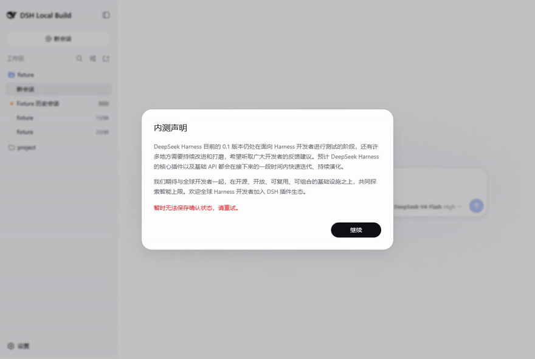

**② 明细面板**：官方余量卡（有官方分母才画条、才给百分比）+ 一张卡里的多窗口计量条：

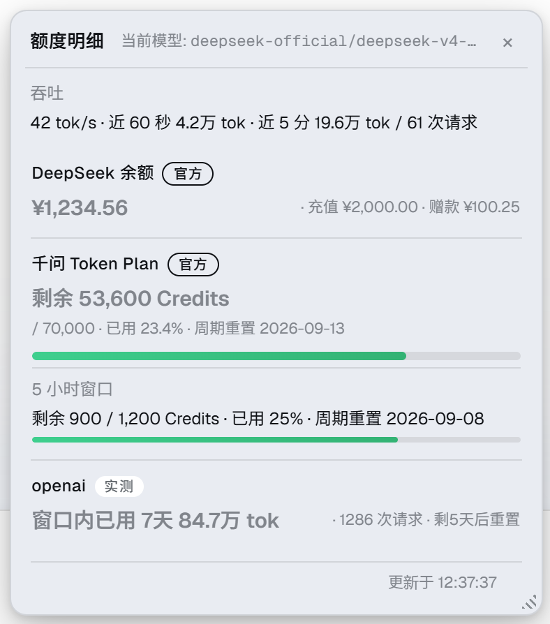

**③ 面板可以拖成悬浮小窗**（拖标题栏，双击复位）：

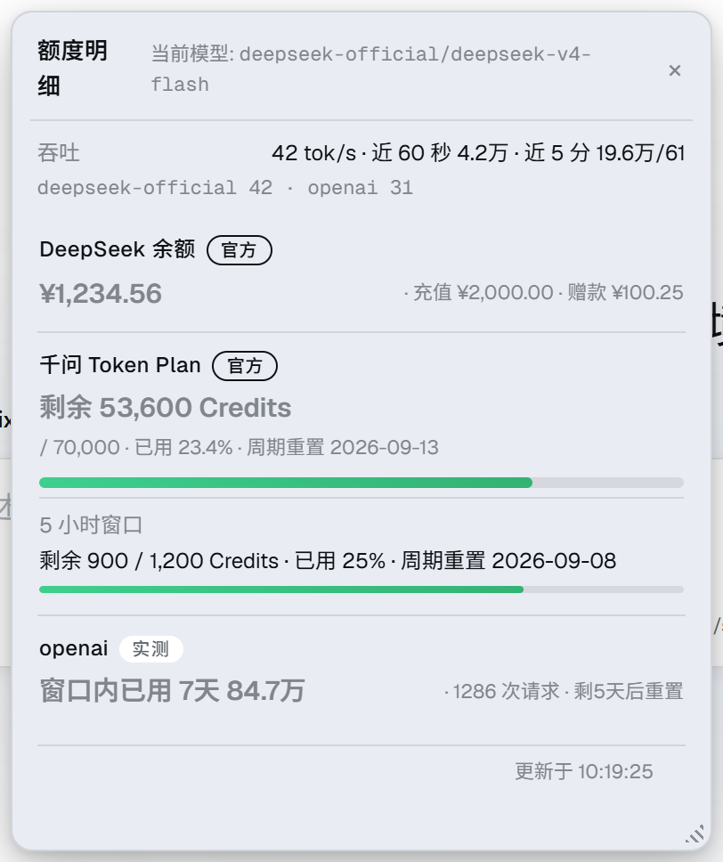

**④ Cookie 掉线时退回「实测」卡**：官方卡变成一张写清原因的**错误卡、不带任何数字**，兜底的实测卡留在徽标上——
没有官方分母就不画条、不报百分比：

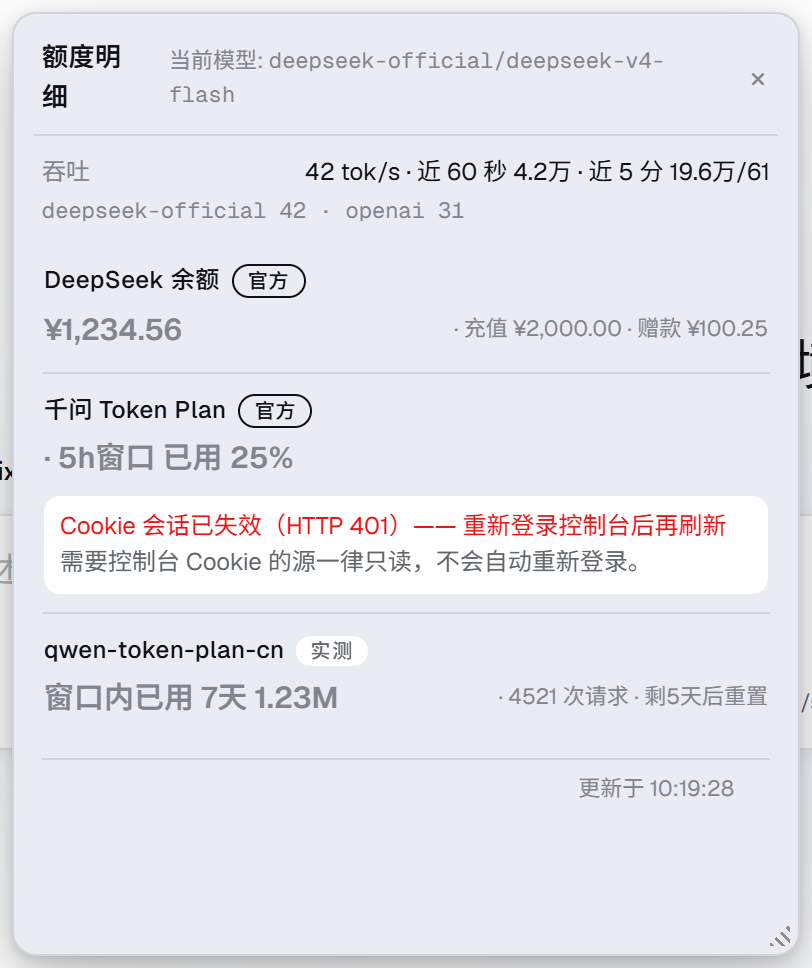

**⑤ 按钱计费的模型也认得**：DeepSeek 的余额是官方真值，但它没有"总量"这个分母 ⇒ 不画条、不报百分比，
只把「还剩多少钱、充过多少、赠过多少」原样报出来：

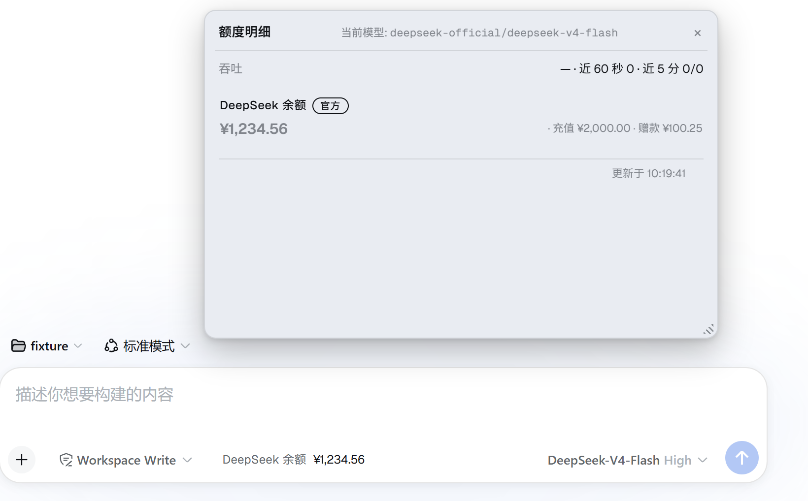

**⑥ 用过的模型会显示额度**：官方接口真给了分母的，才画余量条、才报百分比和周期重置日：

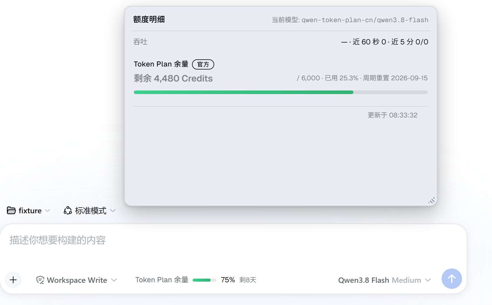

**⑦ 切到本实例没用过的模型时不会显示额度**：这一家没有官方额度接口，而实测账目里还没有它的调用记录
—— 于是徽标写「无官方额度数据」，面板只说清为什么没有，**不会**顺手编一个数：

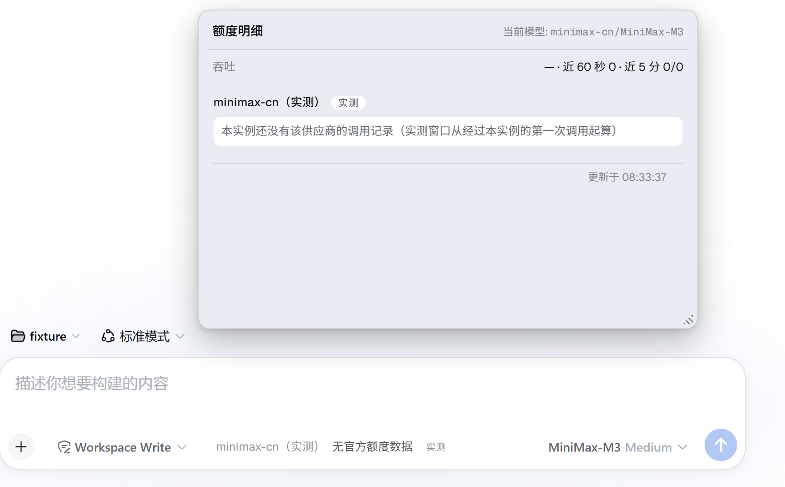

> 上面七张图里的余额、token 数、日期**全部是合成示例**，不是任何真实账号的额度（本插件不会把真实数字放进公开仓库）。
> 英文套只有六张：⑦ 那句解释文案宿主目前只有中文（见 [ROADMAP](https://github.com/xinghe-1018/dsh-token-plan-quota/blob/main/ROADMAP.md)），与其给它编一句英文，不如少一张图。
> 想自己复现或换图：[scripts/shots/README.md](https://github.com/xinghe-1018/dsh-token-plan-quota/blob/main/scripts/shots/README.md)。

## 它不做什么

这是本插件的立场，比功能列表更重要：

- **不折算 Credits**，不做抵扣率，不"按历史推算剩余"；
- **没有"我自己填一个额度上限"的窗口**：分母只能来自官方接口，手填的上限就是编数，所以本插件没有任何
  表达"周期 + 上限"的键。`token-plan-window` **不是**自建窗口预设，它是千问 Token Plan 的本地实测账本
  （不打网络，只记经过本实例的调用）；
- **没有官方分母就不派生百分比**：`used/total`、`100−已用%` 这类算出来的比例一律不出；实测卡永不画余量条、
  永不显示百分比，只报「窗口内用了多少 token / 多少次」。但**上游直接返回的比例属官方真值**——千问控制台
  的 `usage.per1MonthPercentage` 就是它给的数，所以档位额度那一路偶发取不到时（实测会超时），徽标仍显示
  「96% + 条」（条画的就是那个官方比例，不是第二个事实），只是**不报绝对剩余量**（算不出来的东西不显示），并留 `extra.denominatorFailed` 诊断；
- **档位配置不等于你的额度**：一个窗口只有在这个套餐真回了读数时才存在（上游 `quota-config` 里躺着的
  `five_hour` 上限不代表这个账号有 5 小时窗口）；
- **认不准就不开**：自动检测宁可少一张卡，也不会把别家的余额数字顶在你正在用的模型上；
- **不做会产生计费的探活**；只用只读端点；
- **不读别的 CLI 的登录态**（见[明确不做的三类](#明确不做的三类)）。

## 安装

```bash
dsh plugin --profile web add dsh-token-plan-quota          # npm 包名
dsh plugin --profile web add github:xinghe-1018/dsh-token-plan-quota
dsh plugin --profile web add ./dsh-token-plan-quota        # 本地目录
```

`dsh plugin` 是 pnpm 直传到 profile 目录；本插件**零第三方依赖、无构建步骤**，所以不会撞上 pnpm ≥10 的
`prepare` 脚本白名单。装完**重启一次 `dsh web`**（bundle 与客户端入口在启动时组装）。

运行时唯一的外部资源是三枚 CDN 字体 link，加载失败自动落系统字体栈，不影响功能。

## 支持哪些厂家

| 厂家 | 额度来源 | 徽标上看到什么 | 验证到什么程度 |
|---|---|---|---|
| DeepSeek | ✅ 官方 `/user/balance`（Bearer） | 余额 + 充值 + 赠款（真值） | 真实 Key 实测 |
| 千问 Token Plan | ⚠️ 控制台数据网关（**Cookie 会话**，非公开 API） | 已用 % + 进度条（与订阅页同源）；Cookie 没配/过期 → 退回实测卡 | 真账号实测 |
| Moonshot / Kimi 开放平台 | ✅ 官方 `/v1/users/me/balance`（Bearer，`.cn` CNY / `.ai` USD 两区） | 余额 + 充值 + 赠款（真值） | 端点存在性实测；**字段名未用真 Key 核对** |
| OpenRouter | ✅ 官方 `/api/v1/credits`（Bearer） | 余额（USD）＝累计充值 − 累计花费 | 端点存在性实测；**字段名未用真 Key 核对** |
| 阿里云费用中心 | ✅ BssOpenApi（AK/SK 签名） | 账户余额 / 资源包余量（真值） | 逐字段对过官方 OpenAPI 元数据 |
| MiniMax、普通 Key 的 OpenAI / Gemini 等 | ❌ 官方无 Key 化额度端点 | **实测**卡（只报 token/次数） | 常见路径实测过，均无端点 |

逐条端点、信封字段、单位与百分比方向陷阱见 [`docs/upstream-contracts.md`](docs/upstream-contracts.md)。

**只看 API host，不看控制台域名**：`platform.kimi.com`、`platform.moonshot.cn`、
`bailian.console.aliyun.com` 这类**网页控制台**域名一律不参与识别——插件查的是余额接口，落在路由
`baseURL` 指向的 API host（`api.moonshot.cn` / `api.moonshot.ai`）上。Kimi 开放平台的 Key 与 Moonshot
开放平台是同一套账号与余额体系，所以 Key 配好后要走 `api.moonshot.*`；若你的 `baseURL` 写成别的域名，
检测认不出，会退回实测卡。想强制开官方卡，别只写源名——**要把它绑到你真正的路由 id 上**，否则默认
`panelScope: "current"` 下这张卡查得到却不露面（预设自带的 `providers` 是 `moonshot` 这类通用名，不含你的路由名）：

```json
{ "sources": [{ "id": "moonshot-balance", "providers": ["kimi-open-cn"] }] }
```

（下表最后一列请注意：这一家的字段名还没用真 Key 核对过，强制开出来若数字不对，用 `probe` 对字段名。
`providers` 落空时宿主日志会直接提醒，不至于一边是空白面板、一边让人瞎猜。）

### 与相邻插件的区别

生态里已有做同类事的插件，主要是**成本统计 / 费用估算**方向（例如 `dsh-cost-meter`、`dsh-token-monitor`）。
本插件不抢那块，它的口径是**只报真值或明确标注的实测，不折算、不估算**，徽标**跟随当前模型的供应商**切换，
并且内置了**阿里云 / 千问 Token Plan 的控制台余量契约**——那一家有额度却没有公开接口，正是本插件当初被做
出来的原因。要费用报表请选前者；要"我正在用的这家还剩多少"，选这个。

## 结构总览

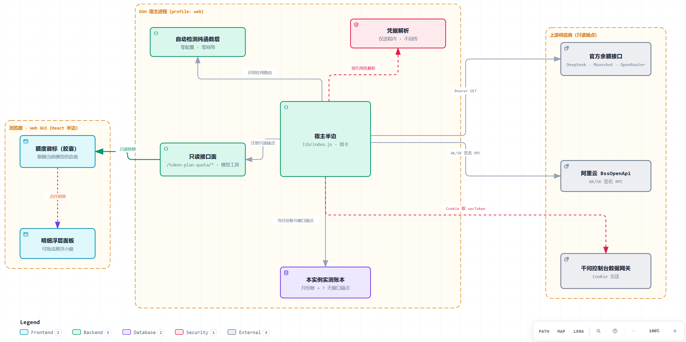

一张图看完半边怎么分工：**浏览器半边**（`lib/client.js`）在输入框工具行渲染跟随当前模型的徽标，
点开是明细面板；**宿主半边**（`lib/index.js`）挂 `llm/stream` 记本实例账本、注册只读路由与
`token_plan_quota` 工具、按零配置检测出的在用路由去查上游；**上游**按有没有官方接口分两类——
有官方接口的报真值（DeepSeek / Moonshot / OpenRouter / 阿里云费用中心），千问 Token Plan 走控制台
数据网关（Cookie 会话）。凭据只进不出：Bearer / AK-SK / Cookie 只在宿主进程内解析，
只读路由与模型工具永不回传。

这张图不是手绘的：源规格在仓库的 `diagrams/` 里，再生成方式与前置条件见
[`diagrams/README.md`](https://github.com/xinghe-1018/dsh-token-plan-quota/blob/main/diagrams/README.md)
（该目录不随 npm 包发布）。

## 零配置自动检测

宿主在用的供应商路由就是**唯一事实来源**，所以你不用写 `sources`，也不用手填 `providers`——历史上正是这两个
字段各写各的，导致"卡查得到却永远看不见"。识别按可信度排序，命中即停：

| 依据 | 说明 |
|---|---|
| `baseURL` 的 host | 最可信：路由实际打到哪。`api.moonshot.cn` → Moonshot 大陆区，`openrouter.ai` → OpenRouter，Token Plan 网关 → 千问 |
| 路由 id / 名称关键词 | **只在拿不到 host 时**降级使用（出厂的 `deepseek-official` 就靠这条） |
| Key 前缀 | 最后的线索（`sk-or-` → OpenRouter） |
| 都没命中 | 给**每条**认不出的路由各挂一张 `window:<provider>` 实测源：徽标不空，只报本地 token/次数 |

**本文里 `provider`、`路由 id`、`providers` 数组里的字符串是同一个东西**：宿主 `llm.listProviders()` 返回的
`id`（比较时忽略大小写，`.` `_` `/` 一律当 `-`）。所以 `window:minimax-cn` 的实测卡只在路由 id 为
`minimax-cn` 的模型下出现，检测自动挂的兜底卡也叫这个名字（`window:minimax-cn`）——两个写法指同一张卡。

两条不变量：

- **你写过的永远赢，但它是一层叠加，不是替换**。`autoDetect: true`（默认）时，你写的 `sources` 先落地，
  检测再补齐**你没管的部分**——不会因为多写了一条就把它不认识的卡全清掉。"已覆盖"只有三种精确含义：
  ① 你某条源的 `providers` 里含这个路由 id → 该路由不再追加任何源；② 你有一条同名 `id` 的源 → 检测不再开
  同名源（`skipped` 记 `id-taken-by-configured`）；③ 你写了 `{"id":"<源名>","enabled":false}` → 这个名字
  永不再自动开（`skipped` 记 `disabled-by-config`）。此外还有第四种可能：凭据解析不到的源整个不开
  （`skipped` 记 `no-credential`，并列出试过哪些引用名；不挂错误卡占地方）。
  `autoDetect: false` 才是"以你写的为唯一事实"。
- **可解释**。每张自动开出的卡带 `detected: {by, rule, host, fallback}`，标题 tooltip 写
  「按 api.moonshot.ai 自动识别 · 区 international」；快照的 `detection` 块交代在用路由、开了什么、
  谁因何被跳过、谁没被认出——排查"这家怎么不显示"只看这一处（**它只在
  `GET /token-plan-quota/summary` 的返回里，明细面板不显示这一坨**）。老宿主没有 `llm` 服务时静默退回配置语义。

## 界面

- **徽标跟随模型**：订阅宿主现成的 `sessions.list` → `modelDirectories` 运行时 store，模型一切换立刻改卡，
  不轮询、不打网络。优先级：有数字的官方卡 > 有数字的实测卡 > 报错的官方卡（提示去配 Cookie）。
- **一家只展示一张额度卡**：官方卡有数字时收起自动挂的实测兜底卡；官方卡变错误卡时兜底必须回来。
  收合发生在看得见数据的显示层，不在规划期——否则 Cookie 一过期徽标就空白。
- **一张卡可以有多个窗口**：宿主按主次排进 `card.meters`（**这是快照里的卡形状，不是手写条目的配置键**），
  `meters[0]` 与顶层数值同源、由标题行与大条表达，
  其余窗口各出一行「标签 · 剩余/总额 · 已用% · 重置日」带自己的细渐变条。
- **明细是常驻小窗**：可拖（按住标题栏）、可缩（右下角握柄）、位置与尺寸记进 `localStorage`、双击标题栏归位。
  **点哪儿都不会关掉它**——关闭只由标题栏那颗 `✕`、再点徽标或 `Esc` 决定。不做「点外面就关」：那是下拉菜单的语义，
  而且靠选择器识别宿主输入区必然漏（线上产物里连 `data-composer-card` 都不存在）。
- 视觉：幽灵小控件，无边框、无状态圆点、无表情符号，**余量渐变条即状态**（≥70% 绿、40–70% 蓝、<40% 橙→红）；
  「官方／实测」药丸标档级；字体自成一套（Geist Variable + Noto Sans SC，断网落系统栈），等宽只留给标识串；
  所有动效尊重 `prefers-reduced-motion`。
- `panelScope: current`（默认）只列当前模型供应商的卡；想全看设 `"all"`。
- **"实测"在本文只有一个意思**：本地账本算出来的数，不是官方余量。它出现在三处——明细里的「本实例实测用量」块
  （`showInstanceWindow` 管这块的显隐）、任意供应商的 `window:<provider>` 卡、以及内置的 `token-plan-window`
  （就是千问那条账本）。三者默认窗口 7 天，`windowDays` 可改；重置时刻由本实例第一次调用起算，
  点「清本周期账本」重新起算。

## 用量统计（本实例实测）

徽标小窗底部的「用量统计」按钮打开一张**独立整页**——替换会话主区，侧栏保留；`Esc` 或标题行的 `✕` 回会话：

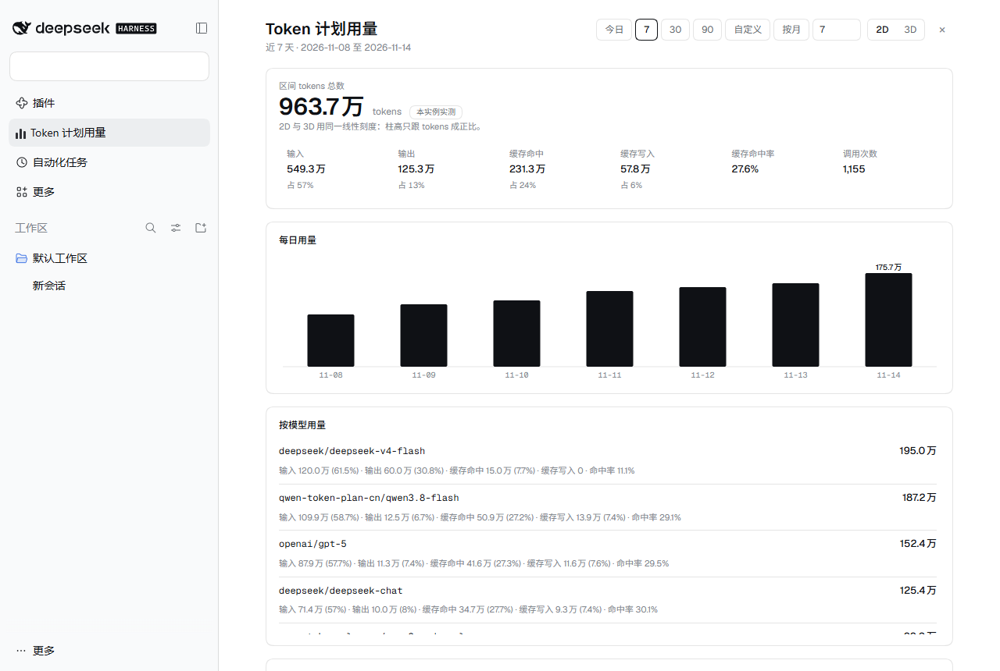

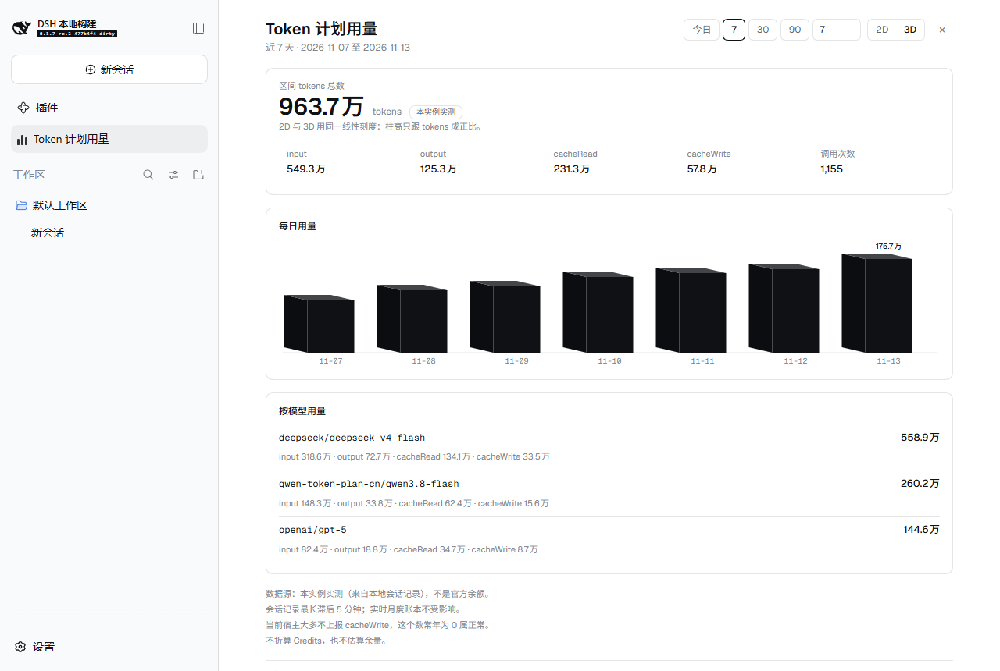

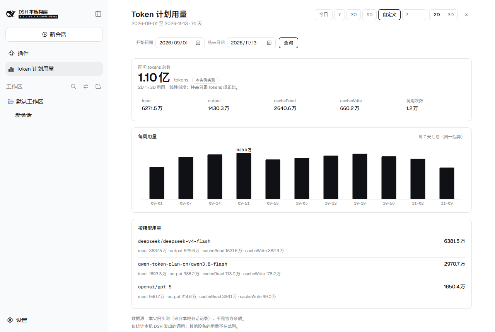

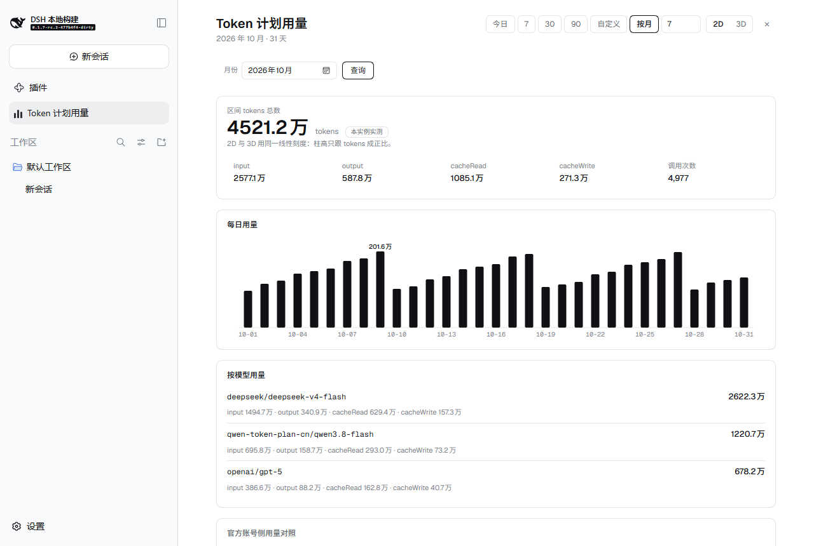

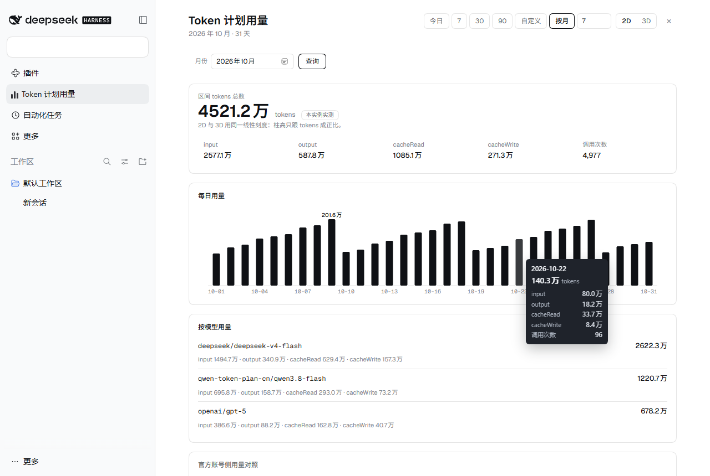

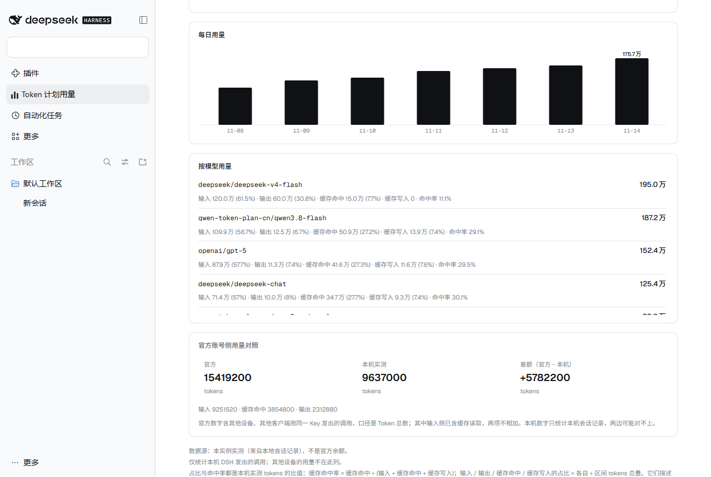

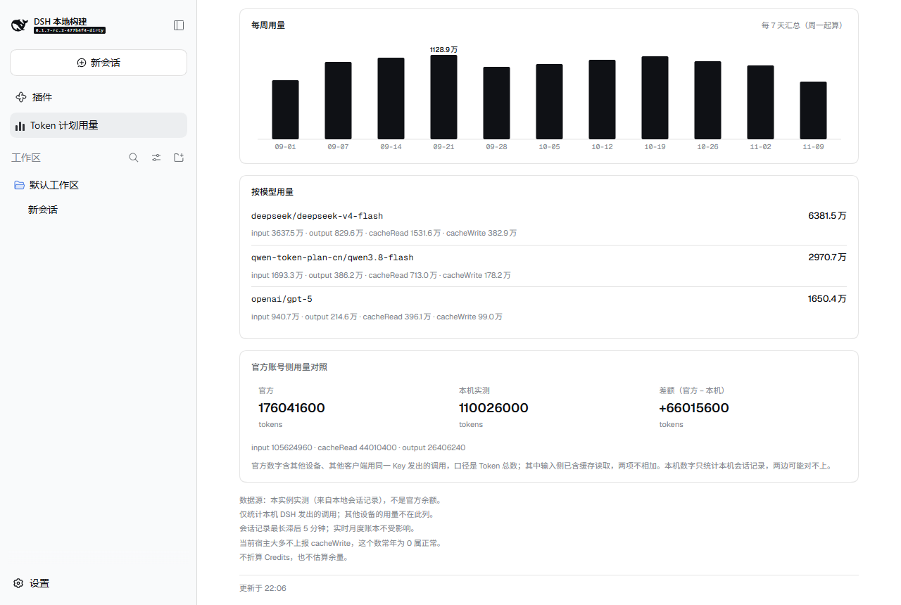

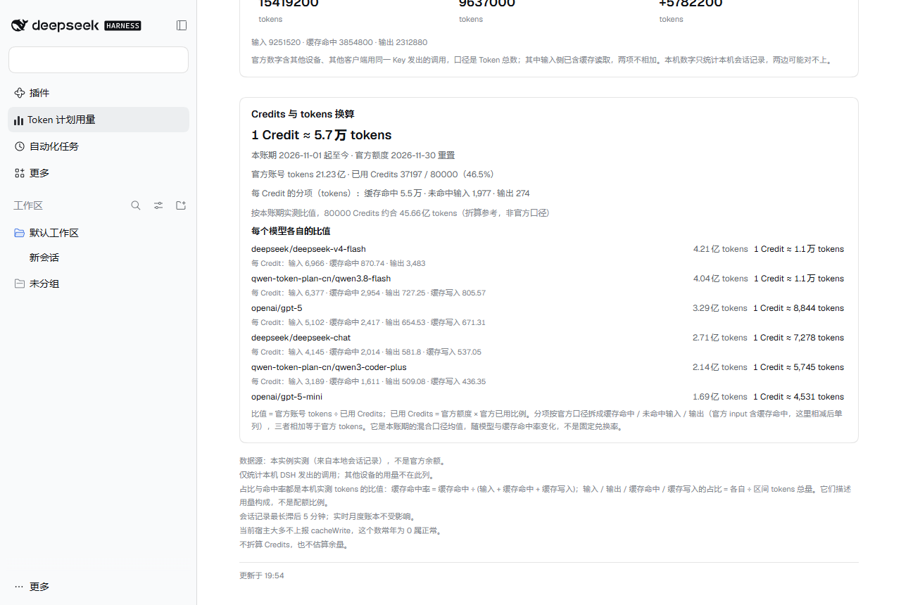

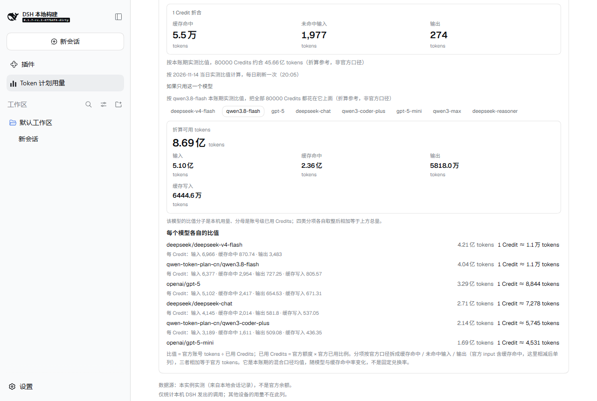

- **只报绝对 token**：区间总量、四类拆分（输入 / 输出 / 缓存命中 / 缓存写入）、调用次数、按模型排行。
  这一屏回答「最近用了多少」，不回答「还剩多少」——所以没有配额百分比，也没有 Credits。
- **看得懂构成**：总量卡除四个绝对值外，还给出每一项**占区间总量的比例**，以及
  **缓存命中率**（缓存命中 ÷（输入 + 缓存命中 + 缓存写入），保留一位小数；分母为 0 时显示 `—`）。
  模型排行每行同样带四类占比与命中率。这些都是**用量构成**，不是剩余额度，也更不是配额比例。
  两个公式不再上屏（024 撤掉脚注），算法与口径只写在本节与 `specs/` 里的 012 / 024 规格。
- 数据来自**宿主自己的会话事件**（`sessionPersistence`），离线折叠成按本地日的索引：首轮要扫一遍历史会话
  （本机实测：215 个会话、211 MB，解码加折叠 20 秒量级），之后每 5 分钟增量同步，数字最多晚 5 分钟。
  它和明细里的「本实例实测用量」不是一套：那一块是**窗口**（默认 7 天，从第一次调用起算），这一屏是**按日/按周的历史**。
- 天数自选：今日 / 7 / 30 / 90 四个预设 + 自定义 1..365（超出范围自动夹回并回填输入框）。
  **超过 62 天自动按周聚合**（以本地周一为界，首末桶可不足 7 天）——365 根日柱既画不下，也看不出趋势。
- 也能按**起止日期**查：预设旁边的「自定义」展开两个日期框，选 9 月 1 日到 9 月 30 日就只看这 30 天（两端都含）。
  非法输入（空、格式不对、开始晚于结束、开始在未来）在**本地拦下、一个请求都不发**；跨度上限与索引保留天数
  共用 `usageBackfillDays`（默认 365 天），结束日晚于今天会被夹到今天，屏上的范围一律按**夹紧后的真值**写。
  超过 62 天同样按周聚合，但**首末桶贴着所选区间**——不为了凑整周把区间外的日子算进来。
- 也能按**自然月**查：预设旁边的「按月」展开一个月份框，选 2026-10 就只看这个月（1 号至月末，一天一根柱）。
  当前月只到**今天**（结束日夹紧，屏上按真值写）；月份格式非法或选了未来月在本地拦下、零请求。
  `month` 与 `from`/`to` 不能混用（宿主回 400 `usage-bad-range`），月份不合法/在未来回 400 `usage-bad-month`。
- **官方账号侧对照**（可选，配 `officialUsage` 打开）：柱子下面另有一条对照条，把同一段时间的
  **官方「Token Plan 用量明细」**（账号级 tokens）与本机实测并排，第三格是「官方 − 本机」的差额。
  官方那边包含同一把 Key 在**其他设备 / 其他客户端**上的调用，所以差额就是「本机之外用了多少」；
  差额为负不是算错——那说明这段时间官方明细里没有全部计入（结算滞后，或只统计走 Token Plan 专用 Key 的调用）。
  两格的 token 口径同义：缓存命中在两边都只算一次（官方把它含在 `input` 里，`total = input + output`），所以可以直接相减。
  这一格同样只取绝对 token，没有百分比与 Credits；官方接口最早只到「当前月往前 5 个月」，
  更早的查询会被夹到那个起点并在屏上写明**被夹掉的原起点**；长区间按 30 天自动分片再拼（网关实测上限就是 30 天）。
  取不到时（没配 Cookie / 会话过期 / 上游失败）这一格**只显示一句可操作的提示，不渲染任何数字**——
  绝不把「取不到」画成 0。
- **Credits 与 tokens 的换算**（需控制台源可读）：官方只给「额度 × 已用比例」的 Credits，这一块把它和**同一账期的官方账号级 tokens**
  相除，给出本账期实测比值 `1 Credit ≈ N tokens`，并并排列出官方 tokens、已用 Credits / 额度与官方已用比例，比值可以自己复核。
  已用 Credits = 官方额度 × 官方已用比例；分子一律用官方账号级 tokens（含其他设备），**不用本机 tokens**——两者口径不同，
  混用会让比值偏小。账期取当前月度计量（没有月度就退到 7 天窗口），**与上方查询区间无关**：Credits 只有当前账期一个读数，
  按区间等比例拆就是估算，所以不拆。它是**本账期的混合均值**：换模型、换缓存命中率都会变，不是固定兑换率（这句解释已按 024 从面板撤掉）；
  「额度折合多少 tokens」那一行只是折算参考、非官方口径。官方明细被夹到更晚的起点、缺额度、缺重置时间、只有 5 小时计量时
  **不给比值**，只说明原因——不拿部分区间凑数，也不用本机数字顶替。
- **每 Credit 的三格折合卡片，以及每个模型各自的比值**：换算块里的「1 Credit 折合」是一张三格卡片
  （标题随界面语言：中文「1 Credit 折合」、英文 "One credit is worth"），按**缓存命中 / 未命中输入 / 输出**
  固定顺序各给一格：标签、**20px** 的数值与单位 `tokens`，数值是这一类每 Credit 折合多少 token。口径只取官方：
  官方 input **含**缓存命中，所以先相减再单列，三格之和等于官方 tokens——直接拿官方 input 当未命中输入，
  三项相加会超过总量。任一格缺 `perCredit`（旧宿主）时**整张卡不渲染**，不写 0、也不写 `—`。
  卡片下方注明折算基准的日子：「按 {day} 当日实测比值计算，每日刷新一次（HH:MM）」，时间取**读者本地时区**的
  刷新时刻；宿主按**自然日**缓存这份折算基础（同一天 + 同一账期直接复用、只向官方取一次），跨日、跨账期或
  手动刷新才重算，官方读数不可用 / 写盘失败 / 旧宿主时这行不出现。每个模型各自的比值 =
  **本机该模型 tokens ÷ 本账期已用 Credits**，这是**贡献口径**：官方不按模型拆分 Credits，也没有公开的模型单价，
  按 tokens 比例去分摊只会让每行都等于总比值（假精确）；各行相加约等于本机总量，与账号级官方总量有少量差额。
  这两句口径说明已按 024 从面板撤掉。模型行再往下拆一层：**该模型的输入 / 缓存命中 /
  输出各自除以同一个账号级分母**，直接回答「1 Credit 对应该模型多少输入、多少缓存命中、多少输出 tokens」，
  三者相加等于该行总量；分母仍是本账期已用 Credits（账号级），不是该模型自己的额度。
  分项卡片或模型行缺失时只少渲染那一块，不写 0、也不写 `—`。
  折算基础落在 `creditsDailyPath` 指向的快照文件里（见下方配置表），删掉它下一次请求就会重算。
- **如果只用单个模型（023）**：独立的「如果只用单个模型」一节（`section.tpq-usage-single-model`，
  `data-usage-single-model="1"`，`data-stale` 与全屏快照同源）排在「1 Credit 折合」换算卡之后，标题
  `h3.tpq-usage-single-model-title` 逐字「如果只用单个模型」。节内能挑一个模型，看把本账期全部 Credits 都花在
  它身上能换多少 tokens。chip 是原生 `button`（`data-usage-credits-modelpick-chip`，`data-model` 存模型 id、
  `data-selected` 与 `aria-pressed` 同源），可 `Tab` 聚焦、可回车切换，选中态只记 id，默认第一项。
  结果卡（`data-usage-credits-modelpick-card`）先给总值（`formatTokens(...)` + 单位 `tokens`），再按
  **输入 / 缓存命中 / 输出** 三格拆开；该类容量 > 0 时才追加第四格「缓存写入」，为 0 就不出现——不写 0。
  四格各自取整后相加等于总值。
  有公开忙时单价的模型（qwen3.8-flash、deepseek-v4.1-flash-1017、deepseek-v4.1-flash）主数字用 022 的
  「按官方价目估算」，卡片标签同步写成「按官方价目估算 tokens」（响应里的 `ratio.priceBasis` 标明口径、取价日
  与单位）；没有价目时回落 019 的占比折算 `capacity`，两套口径共用同一张卡、不混算。卡片与数字之外不再挂
  小字说明：口径写在本文与规格里。025 起模块内除 chips 与结果卡外，只保留一行夜间折扣说明
   `p.tpq-usage-single-model-note`（「按官方忙时价目估算，未计 22:00–08:00 夜间折扣；实际可用 tokens 会更多。」），
   仅走 022 `estimate` 口径时渲染。旧宿主没有 `capacity`、没有可算模型、或
  credits 未就绪时整块不渲染，不拿 0 顶替。
- **按官方价目估算（022）**：有公开忙时单价的模型（qwen3.8-flash、deepseek-v4.1-flash-1017、deepseek-v4.1-flash）主数字改用「把本账期全部 Credits 都花在该模型上」的估算 tokens：先按官方单价算该行价目成本，再除以本账号实测的每 Credit 价目成本（响应里的 `ratio.priceBasis` 标明口径、取价日与单位）。未计 22:00–08:00 夜间折扣与没有公开单价的模型；无估算时逐字段回落 019，`capacity` 仍保留，两套口径并存——估算是参考，不是官方读数。
- 2D / 3D 共用**同一个线性比例函数**：3D 只是把同一根柱子画成 SVG 等轴投影的三面（顶 / 正 / 侧），
  固定角度、无透视、无近大远小，柱高与数值严格线性——换画法不会让柱子看起来比数据高。
- **把鼠标放到任意一根柱上**就能看到该柱的明细：日期（周桶写作 `起 – 止`）与该桶 tokens 总量，
  下面四类拆分与调用次数。2D / 3D 都支持；触屏点按、键盘 `Tab` 聚焦同样会弹出（`Esc`、点别处、
  滚动都会收起）。浮层只报绝对 token，不派生百分比，也不折算 Credits。
- **模型排行在卡内滚动**：列表高度封顶（约 4 行），更多模型用细滚动条翻；容器本身可 `Tab` 聚焦，
  键盘与读屏都能滚。这样模型再多也不会把官方对照和脚注挤出屏幕。
- **整页可上下滚动**：整屏包在一层滚动视口里（`data-usage-scroll="1"`，细滚动条、可 `Tab` 聚焦、
  `PageDown` / `End` 可滚），内容比宿主主区高时不再被裁；模型排行仍是卡内滚动，两层各自独立。
- **模型名取自会话 header 的真值**：某段切片没有新的 header 时，沿用该会话上一次声明的 `provider/model`，
  不会因为「中途没再声明」把整段掉进「未知」；日志里确实从未声明过 header 的会话仍如实记为未知，不猜。
- 统计不到的时候会明说：宿主没有 `sessionPersistence` → 退回「本进程启动以来」（重启归零）；历史还没回填完 →
  顶部细进度条与「正在回填（N/M 会话）」；关掉统计 → 屏内直接写已关闭，不把「统计不到」伪装成 0。
- **重启后不用先聊一句**：索引在第一次查询时就同步从磁盘读回来（以前要等启动 20 秒后的首轮同步，
  在那之前打开统计屏只有一堆 0，得先发一句话把同步踢起来）。现在重启 DSH 后直接开屏就是上次的数字。
- **会补扫宿主列表之外的会话**：宿主的会话列表偶尔漏掉个别会话（本机实测 217 个会话目录里有 2 个不在列表里，
  合计约 6,500 万 tokens（多数落在 9 月）一直没被算进去），所以同步末尾会按 `$DSH_HOME/sessions` 的目录结构直接读这些日志补进来：
  只读**最高版本**的日志文件、按文件大小与修改时间做签名（没变就跳过）、每轮最多扫 64 MB（超了下一轮接着来），
  fork 会话按日志里的继承标记截断，避免跟父会话重复计一次。补进来的会话数在屏上脚注里写明。

落盘索引在 `$DSH_HOME/token-plan-quota.usage-index.json`，只存计数与 `provider/model` 标识，
**没有消息文本、请求头或文件路径**；文件坏了会备份成 `.bad-<毫秒>` 再重建，不让一份脏缓存顶掉整张图。
## 配置

主配置 `~/.dsh/token-plan-quota.json`——宿主每次查询前重读，**改完不用重启**（也可写在插件行 `config`，
JSON 优先级更高）：

```json
{
  "autoDetect": true,
  "refreshMinutes": 10,
  "pollSeconds": 10,
  "panelScope": "current",
  "debug": false
}
```

下表 27 行：26 行是代码里 `DEFAULTS` 的键，另 1 行 `moonshotRegion` 不在 `DEFAULTS` 中——它是 Moonshot 源
通过 `regionConfigKey` 读取的区选择器。**一个键一行，单位都写在键名里**（`Minutes`/`Seconds`/`Ms`）。

| 键 | 默认 | 含义 |
|---|---|---|
| `autoDetect` | `true` | 按宿主在用路由自动补齐数据源。**写 `sources` 不会把它关掉**：你写的是一条叠加层，检测照样补齐你没管的路由，所以 `"sources": []` 只表示"我没额外要求"（与不写等价）。设 `false` 才是"以你写的为唯一事实"：此时什么都不写 → 回落到内置两条 `deepseek-balance` + `token-plan-window`；写 `"sources": []` → **一张卡都没有** |
| `sources` | 无（交给检测） | 数据源清单，按顺序显示。内置源名（8 个）：`deepseek-balance`（DeepSeek 余额）、`token-plan-console`（千问控制台余量，Cookie）、`token-plan-window`（**千问本地实测账本**，非自建窗口）、`moonshot-balance`（Moonshot/Kimi 余额）、`openrouter-credits`（OpenRouter 余额）、`account-balance`（阿里云账户余额）、`fr-instances`（阿里云资源包实例列表）、`resource-package`（阿里云资源包额度列表）；或简写 `window:<provider>`（给任意供应商挂实测窗口）；或完全自定义对象（见[自定义源](#自定义源)） |
| `moonshotRegion` | `china-mainland` | Moonshot 区：`china-mainland`（`api.moonshot.cn`，CNY）/ `international`（`api.moonshot.ai`，USD）。**两区 Key 不互通**，选错会 401（卡片会直接提示切区）；host 与币种成对切换，不做自动探测 |
| `refreshMinutes` | `10` | 官方源的快照缓存分钟数：TTL = 分钟 × 60 秒，**下限 15 秒**，所以 `"refreshMinutes": 3` 就是每 3 分钟回源一次（想比 1 分钟更勤没有意义，秒级刷新请看 `pollSeconds`）。点面板「更新于」或带 `?fresh=1` 可强制回源 |
| `pollSeconds` | `10` | 前端轮询秒数——只管界面多久取一次快照，实测与吞吐每次实时重算；调小让徽标速度更跟手，不会多打上游 |
| `panelScope` | `current` | 明细面板范围：`current` **只列 `providers` 里含当前路由 id 的卡** + 本实例实测；`all` 列全部源。所以 `current` 下**看不到阿里云那三条**——账户余额与资源包没有供应商归属，永远不进按路由过滤的视图，要看它们就设 `"all"` |
| `showInstanceWindow` | `true` | 明细里是否带「本实例实测用量 + 限流重试观测」这一块。它**不是**某个数据源的开关，也不影响 `window:<provider>` 卡 |
| `exposeTool` | `true` | 是否注册模型可调用工具 `token_plan_quota` |
| `debug` | `false` | 明细里常驻回显上游响应的**字段骨架**（值打码、跳过凭据字段名）。与 `GET /token-plan-quota/probe?source=<id>` 输出同一份东西，区别是 debug 常驻、probe 按需单次且不用改配置 |
| `endpoint` | `business.aliyuncs.com` | 仅阿里云费用中心三个源使用：OpenAPI 接入点（国际站要换）。会自动剥掉 `https://` 与末尾斜杠 |
| `allowUndeclaredHosts` | `false` | 出站白名单的**用户侧开关**：默认只允许 `dshhub.permissions.network` 里声明过的 8 个主机（回环除外），其余在请求发出前就被拒（错误码 `HostNotDeclared`）。自定义源指向别处时必须显式打开——打开后快照里会留一条 notice，不静默降级。内置源报这条说明代码与声明不一致，`lib/index.js` 的 `DECLARED_HOSTS` 与 `package.json` 要一起改 |
| `regionId` | 无 | 仅阿里云使用：OpenAPI 的 `RegionId` |
| `accessKeyIdRef` | `ALIBABA_CLOUD_ACCESS_KEY_ID` | 仅阿里云使用：AccessKeyId 的凭据引用名 |
| `accessKeySecretRef` | `ALIBABA_CLOUD_ACCESS_KEY_SECRET` | 仅阿里云使用：AccessKeySecret 的凭据引用名 |
| `securityTokenRef` | 无 | 仅阿里云使用：STS 临时凭据的引用名（用 AK/SK 长期凭据时留空） |
| `configPath` | `$DSH_HOME/token-plan-quota.json` | 外部 JSON 配置位置（`~/` 落 OS 家目录，`$DSH_HOME/` 落 harness 家目录） |
| `usagePath` | `$DSH_HOME/token-plan-quota.usage.json` | 本实例账本落盘位置（当月累计与窗口锚点） |
| `usageStats` | `true` | 用量统计（把会话事件折叠成按本地日的 token 历史）的开关。关掉 = 不同步、内存也不累计；**入口保留**，统计屏里直接写已关闭并提示这个键——不删已有索引，也不影响上面那些额度源 |
| `usageIndexPath` | `$DSH_HOME/token-plan-quota.usage-index.json` | 用量索引落盘位置。与 `usagePath` 的月账本是**两个文件**：一个是按天的历史（统计屏用），一个是当月累计（明细里的本实例实测用） |
| `creditsDailyPath` | `$DSH_HOME/token-plan-quota.credits-daily.json` | 折算基础的按日快照落盘位置（当天官方 tokens / 已用 Credits / 三类 per Credit）。**同一天 + 同一账期复用**，跨日、跨账期或手动刷新时覆盖；删除文件下一次请求即重算。只缓存折算基础，不缓存官方读数 |
| `usageBackfillDays` | `365` | 索引保留天数，同时是统计屏可选天数的上界（1..365）。调小会裁掉更早的日桶；调大后从下一轮同步开始往回补 |
| `officialUsage` | `true` | 统计屏里是否显示「官方账号侧」对照条：走控制台网关的 Token Plan 用量明细（账号级 tokens，与上面那些额度源无关）。关掉 = 不发这次出网请求，柱子与本机数字照旧 |
| `officialUsageMinutes` | `5` | 官方对照的缓存分钟数：同一区间在 N 分钟内复用上次结果（`0` = 每次回源） |
| `usageScanFallback` | `true` | 同步末尾是否按 `usageScanPath` 的目录结构补扫宿主会话列表之外的会话日志。关掉 = 只信宿主给的列表（就会漏掉被它隐藏的会话） |
| `usageScanPath` | `$DSH_HOME/sessions` | 兜底扫描的根目录（两级：项目目录/会话目录/日志文件） |
| `minIntervalMs` | `1200` | 出站最小间隔（毫秒），全局节流 |
| `timeoutMs` | `15000` | 单次上游请求超时（毫秒，下限 1000） |

### 只想关掉某一张卡

`sources` 的一项既可以写成内置源名（字符串），也可以写成对象——**选项只有对象形式带得上去**，所以想关掉某一张卡，
要把那一项改成对象。**这是一条排除项，不是整张清单的替换**：`autoDetect` 保持 `true`，其余卡照常补齐。

```json
{
  "autoDetect": true,
  "sources": [
    { "id": "deepseek-balance", "enabled": false },
    { "id": "fr-instances", "enabled": false }
  ]
}
```

- **对自动检测开出来的源同样有效**：写了 `{"id":"moonshot-balance","enabled":false}`，检测就不会再把这张卡补
  回来，诊断块的 `skipped` 里留一条 `disabled-by-config`——「没认出来」和「你关掉了」这两种情况得分得开。
- **关的是这一条源，不是这个供应商**——但"这家还剩什么"取决于它在不在规则表里，这一条必须说白：
  - **认得出的厂家**（DeepSeek / Moonshot / OpenRouter）各自只有一条官方源，关掉它**就没有这张卡**：
    实测兜底窗口只挂在**认不出**的路由上，不会因此补上来。
  - **千问是唯一的例外**：它同时有 `token-plan-console`（官方）与 `token-plan-window`（实测）两条预设，
    关掉前者，后者照旧在。
  - **认不出的厂家**（MiniMax 这类）本来就只有一张 `window:<provider>` 卡，要关它就点它的名：
    `{"id":"window:minimax-cn","enabled":false}`（`<provider>` 就是路由 id，见上节）。
- 不想逐张关，就把 `autoDetect` 设 `false` 之后自己列全清单。两种做法都行，**你写过的永远赢**。

### 凭据

按顺序解析：**DSH 凭据服务 → 环境变量 → `~/.dsh/.credentials.yaml` → `~/.dsh/.env`**，每次查询重新解析，
换 Key 不用重启。

| 源 | 引用名 |
|---|---|
| DeepSeek | `DEEPSEEK_API_KEY` |
| Moonshot | `MOONSHOT_API_KEY`（须与区配对；自动检测会优先沿用路由 profile 点名的引用名，如 `MOONSHOT_CN_API_KEY`） |
| OpenRouter | `OPENROUTER_API_KEY`（`sk-or-v1-…`） |
| 千问 Token Plan 余量 | `BAILIAN_CONSOLE_COOKIE`（+ 可选 `BAILIAN_CONSOLE_SECTOKEN` 兜底） |
| 阿里云 | `ALIBABA_CLOUD_ACCESS_KEY_ID` / `ALIBABA_CLOUD_ACCESS_KEY_SECRET` |

Key 引用名可在 `sources` 条目里用 `bearerRef` / `cookieRef` 覆盖。

想看到千问的**真实余量**（订阅页那种「剩余量 76.2% / 总额度 10,000」）：登录打开
[订阅页](https://platform-home.qianwenai.com/analytics/token-plan/individual) → 按 F5 → F12 Network（勾**保留日志**）
→ 筛选框输入 `cs-data` → 复制 **`cs-data.qianwenai.com/data/api.json`**（`action=BroadScopeAspnGateway`）那条请求的
**整行 `Cookie:`** → 存成一行 `BAILIAN_CONSOLE_COOKIE: <内容>` → 点面板「更新于」刷新。
三条硬要求，缺任何一条这张卡都会报错，而**错误码把责任分得很清楚**：

- **必须是插件实际调用的那台主机**（`cs-data.qianwenai.com`）。Cookie 按域隔离，从别的控制台域名抄来的用不了
  （2026-10 实机踩过两次：先按旧提示筛 `bailian-cs` 一条请求都筛不出来；改成从阿里云那侧抄来
  `cna/cnaui/… + login_aliyunid_csrf`，网关照样拒绝）。→ `BailianGateway.Login.NotLogined`，正文点名缺哪张票据。
- **里面必须有登录票据 `login_qianwenai_ticket`**。只有反爬 Cookie 集（`cna`、`cnaui`、`aui`、`sca`、`atpsida`、
  `tfstk`、`isg`、`partitioned_cookie_flag` 这类）而没它，就说明抄的是另一条不带登录态的请求。同上。
- **`sec_token` 必须附得上**。它由 `platform-home.qianwenai.com/tool/user/info.json` 用同一份 Cookie 自动取；
  取不到时报 **`MissingSecToken`** 并带上失败原因（`no-token` / `http-<状态>` / `network:<错误名>`）——
  **这不是 Cookie 抄错**：重试一次，或按提示把响应里的 `secToken` 手配成 `BAILIAN_CONSOLE_SECTOKEN`。
  原因写成 `no-token` 时，错误里还会附上那份响应的**字段名骨架**（只有名字与类型，值绝不出现）——
  据此判断 token 是改了名、挪了层，还是这个会话压根没发 token。
  2026-11-03 实机就是撞在这条上：票据明明在场，旧文案却一律断言"多半抄的是另一台主机"，照着重抄永远修不好。

票据与 `sec_token` 都在、网关仍然拒绝，那只剩**会话过期**这一条（Cookie 一般能用几周）：重新登录订阅页，
当场再抄一条。被拒时面板里的错误会**列出收到的 Cookie 名与插件打的主机**，照着对一下就知道错在哪一步。

### 自定义源

上游给了新端点、或你想把某个控制台接口接进来，不用等本插件更新——`kind: "single"` + `fields`/`derive`
就能覆盖"余额是差值"这类形态：

```json
{
  "sources": [{
    "id": "my-balance", "label": "我的余额", "kind": "single", "metric": "money",
    "url": "https://example.com/api/account", "method": "GET", "bearerRef": "MY_API_KEY",
    "unit": "USD",
    "fields": { "credits": ["data.total_credits", "total_credits"], "usage": ["data.total_usage", "total_usage"] },
    "derive": { "total": "credits", "used": "usage", "remaining": "credits - usage" },
    "providers": ["my-provider"]
  }]
}
```

`derive` 只认「一个 `+`/`-`、两侧是 `fields` 里的引用名或数字」；**任何一个操作数取不到就整条空**，绝不猜数补上。
`fields` 的槽位名随你起（`credits`/`usage` 只是示例），它同时也是 `derive` 表达式里能引用的变量名；
每个槽位给多条候选路径是有意为之（同一家 API 版本间 `data` 信封加不加都见过）。

#### 手写条目的全部可用键

**认不出的键不会报错，只是没作用**（条目对象是原样合并进去的），所以键名打错字的表现是"卡片空着"而不是启动失败。
这张表是权威清单：

| 键 | 用在哪 | 说明 |
|---|---|---|
| `id` | 必填 | 源标识，同时是缓存键和 `probe?source=` 的参数。两个条目用同一个 `id` 会共用缓存并叠成两张卡（日志会 warn），第二个请改名 |
| `kind` | 建议写 | `single`（一次读数，不写即此值）/ `list`（多条资源列表）/ `window`（本实例实测窗口，不打网络） |
| `label` / `labelEn` | 标题 | `label` 是卡片标题，不写时回落成该条目的 `id`。界面语言是英文时**优先读 `labelEn`**（面板卡头、多窗口计量条都算），拿不到才退回 `label`——客户端不替你翻译，想要英文标题就在条目里写 `labelEn` |
| `url` | `single` / `list` | 端点。写了 `url` 即 HTTP 源；不写 `url`、也不是内置源名，则按阿里云 OpenAPI **RPC** 处理（要 `action` + `version`） |
| `method` | HTTP | 默认 `GET` |
| `headers` | HTTP | 追加请求头，与 `accept: application/json` 合并 |
| `jsonBody` / `formBody` | HTTP（POST 用） | JSON 请求体 / `application/x-www-form-urlencoded` 请求体 |
| `bearerRef` / `cookieRef` | HTTP | 凭据引用名。Bearer 型只认 `bearerRef`，Cookie 会话型只认 `cookieRef`——**不会拿套餐 Key 去顶替 Cookie**（反之亦然），因为那只会得到一张误导性的错误卡 |
| `action` / `version` / `params` | RPC | OpenAPI 的 Action、版本号、查询参数（`params` 会被扁平化）。RPC 型缺 `action` 或 `version` 会直接出错误卡 |
| `paginate` | RPC | `{ "mode": "page", "request": "PageNum", "pageSize": "PageSize", "total": ["TotalCount"] }`，或 `{ "mode": "token", "request": "NextToken", "response": ["NextToken"] }`；`page` 模式最多翻 10 页 |
| `fields` | `single` | 变量名 → 候选路径数组，取到数的才进 `derive` 作用域 |
| `extract` | `single` | 上游直接给值时的路径：`remaining`、`total`、`unit`。它们也能被 `derive` 引用 |
| `derive` | `single` | 只有 `remaining` / `total` / `used` 三个键会被消费；`used` 不写时，`remaining` 与 `total` 都在就自动算差值 |
| `extra` | `single` | 副信息，键名随你起；`toppedUp`/`granted`/`cash`/`credit`/`quotaLimit` 有既定文案 |
| `list` / `item` | `list` | `list` 是数组候选路径；`item` 内可给 `name`/`id`/`remaining`/`total`/`used`/`unit`/`status`/`expiresAt`/`startsAt`/`cycleType`/`capacityType`/`haystack` |
| `metric` | 显示口径 | `money` / `credits` / `count`。默认值按构建器不同：手写 `single` 源是 `money`，`list` 源是 `credits`，`window` 是 `count`——**要按 token/次数显示就显式写** |
| `unit` | 显示 | 上游不给单位时的兜底（如 `USD`）；`metric:"money"` 且上游不给时兜到 `CNY` |
| `providers` | 面板归属 | 这条属于哪些**路由 id**（见上文「provider 就是路由 id」）。`panelScope:"current"` 下，列表里没有当前路由就不显示这张卡；写了却一条都对不上在用路由，宿主日志会提醒（免得对着空白面板瞎猜）；`window:<provider>` 简写会自动填 |
| `windowDays` | `window` | 实测窗口天数，默认 7，最小 1 |
| `regions` / `region` | 多区供应商 | `regions` 是「区名 → 该区的字段覆盖（host 与币种成对换）」，`region` 选哪一区；写错的区会 warn 并退回第一个 |
| `enabled` | 任意 | `false` 停用这一条（临时关源不必删整段） |

**表外的键是内置预设专用，手写别照抄**：`builder`、`apiPrefix`、`consoleSite`、`gatewayAction`、`gatewayProduct`、
`infoUrl`、`secTokenRef`、`dashboardURL`、`regionConfigKey`、`errorHints`、`keywords` 走的是各家特定的签名/CSRF/
信封流程，只对相应预设成立。特别地：面板里的**多行窗口**（当前账期那一行 +「5 小时」；账期是
「本月」还是「7 天」取决于上游这个账号真回了哪个读数）目前**只有
`token-plan-console` 会产生**，手写条目一条只有一个读数；想显示两个窗口，就写两条源。
实测窗口用 `{"kind":"window","providers":["my-provider"],"label":"我的窗口","windowDays":30}`，
或简写 `window:<provider>`。接入新厂家的完整核对流程见 [`docs/adding-a-provider.md`](docs/adding-a-provider.md)。

#### 卡片空着、又没报错，按这个顺序查

1. `GET /token-plan-quota/probe?source=<id>`（或临时开 `"debug": true`）——先看上游**实际**回了哪些字段名；
   零配置安装里源是自动检测出来的、不写在配置里，`probe` 查不到时会**补跑一次检测**再查（2026-09-23 之前
   它对这类源永远回 `unknown-source`，等于把最有用的诊断入口关掉了）。这次「余量不见了」就是这么定位的：
   `usage` 实际回的是 `per1MonthPercentage`，而代码只认 `per1Week` / `per5Hour`。
2. 对照上面那张权威键表逐字核对键名：**认不出的键不报错、只是没作用**，表现就是卡片空着而不是启动失败；
3. `fields` 的路径是否真命中了这份响应（信封加不加 `data` 见过两种），`derive` 引用的名字是否都取到了数
   ——任一操作数缺失就整条空；
4. 如果这张卡**根本没出现**，那通常不是空卡问题：凭据解析不到的源整个不开（不挂错误卡占地方），
   或者被 `panelScope: current` 挡在视野外。看快照的 `detection` 块，它会写明谁被跳过、为什么。

## 吞吐速度（实测，不估算）

宿主包一层 `llm/stream`，记录**首分片到 usage 分片**的活跃时长。两个口径严格分开：

- **速度（生成/解码）**：`lastTps` = 输出 tokens ÷ 活跃秒；`genTps` = 近 5 分钟 Σ输出 ÷ Σ活跃秒
  （活跃总时长 <1 秒不出数，防超短流外推）。**缓存读不计入分子**——否则一次 36 万缓存命中的调用会把
  速度吹成几万 tok/s；
- **吞吐（量）**：`tpm60` / `tokens300` = 全部 tokens（含缓存读），计费与搬运视角；`outTps60` 是近 60 秒输出均速。

滑动窗口随账本落盘，宿主重启后最近 5 分钟的实测还能带回。速度**不占徽标位**（小胶囊只露渐变条与余量数字），
取数优先级：最近单流（90 秒内）→ 近 60 秒输出均速 → 近 5 分钟生成速度；无新鲜活动不显示。
面板的「吞吐」一行只报**这一实例的聚合值**，不逐家再列一遍速度——逐家数据仍在快照里，需要时走 `action=status`。

## 只读路由与模型工具

| 端点 | 作用 |
|---|---|
| `GET /token-plan-quota/summary` | 快照（官方源吃 TTL；`?fresh=1` 强制回源）；含 `detection` 诊断块 |
| `POST /token-plan-quota/refresh` | 官方源回源 |
| `POST /token-plan-quota/reset` | 清零本实例实测统计（含窗口锚点） |
| `GET /token-plan-quota/usage?range=today|7d|30d|90d` | 按本地日（`days > 62` 时按周）聚合的 token 用量；自定义天数用 `?days=N`（1..365，优先于 `range`）。响应里的 `coverage` 除会话统计外还有 `scanned` / `rescued` / `scanFailed` / `scanDeferred`：`rescued` 是本轮从日志目录补扫进来的会话数 |
| `GET /token-plan-quota/usage?from=YYYY-MM-DD&to=YYYY-MM-DD` | 按起止日期（两端都含）聚合，优先于 `days`/`range`；只给一端、格式非法、开始晚于结束或开始在未来 → 400 `usage-bad-range`；跨度超 `usageBackfillDays` → 400 `usage-range-too-long`（带 `maxDays`） |
| `GET /token-plan-quota/usage?month=YYYY-MM` | 按**自然月**聚合（本地时区，1 号至月末，恒为日桶）；当前月结束日夹到今天。`month` 与 `from`/`to` 混用 → 400 `usage-bad-range`；格式非法或月份在未来 → 400 `usage-bad-month` |
| `GET /token-plan-quota/usage-official?days=N`（也可 `range=` / `from&to=` / `fresh=1`） | **官方账号级 tokens**（Token Plan 用量明细）。参数语义与 `/usage` 完全一致、错误码相同；成功 200 带 `{range, granularity, totals, buckets, source, coverage}`，取不到时 200 + `{error:"official-unavailable", code, hint}`——`code` 是固定枚举（禁用 / 没凭据 / 登录过期 / 超时 / 上游 / 响应不认识 / 只给下载链接），`hint` 可直接展示 |
| `GET /token-plan-quota/probe?source=<id>` | 上游响应字段骨架（排查用） |

只接受同源请求，**永不回传密钥**。模型侧有 `token_plan_quota` 工具（`status` / `refresh` / `reset` / `usage`，`usage` 可带 `days: 1..365`，或 `from` + `to`（`YYYY-MM-DD`，两端含，优先于 `days`），或 `month`（`YYYY-MM`，自然月））。

配合 429：`settings.yaml` 里给该 provider 配 `retryPolicy`（把 `QUOTA` 纳入 `retryableCodes`，
`initialDelayMs == maxDelayMs` + `jitterRatio: 0` 可把退避压成固定间隔）。明细的「自动重试观测」显示真实
发生的重试次数、等待秒数与生效策略——读 `llm/retry` 持久事件的 `policyKey`，不估算。

## 已知边界

- 实测窗口只含**经过本 DSH 实例**的调用：别的设备/工具消耗的额度不在内，官方折算率也不公开，
  所以它只报 token/次数，不报「剩余额度」。
- 上游控制台做过「额度重置」后，本实例窗口不会自动感知，用 `token_plan_quota`（`reset`）重新起算。
- **`reset` 只清月账本与窗口锚点，不清用量索引**：统计屏读的是会话日志折出来的历史，删它没有意义（日志还在，下一轮会折回来）。
- 观测计数是本次进程启动以来的；按天历史在用量索引里（统计屏），两者都只覆盖**经过本实例**的调用。
- 自定义区间里**早于索引覆盖范围**的日子按 0 计：索引只留 `usageBackfillDays` 天，刚装好时能覆盖的历史更短，
  所以那几根 0 柱的意思是「索引里没有这天的记录」，不是「这天一次都没调用」。按月份查更早的月份同理：整月 0 桶只表示索引没覆盖到。
- 补扫只认 `usageScanPath`（默认 `$DSH_HOME/sessions`）下的日志：日志文件被删掉或挪走之后就补不回来；
  单轮 64 MB 预算意味着缺的会话很多时补扫会跨几轮完成，脚注里的 `rescued` 随轮次增长。
- 用量索引的首轮回填是后台跑的：刚装好时先看到的是部分历史，顶部会显示进度；最多等一个同步周期（5 分钟）就是全量。
- 座位退化：外壳没声明 `conversation.input.left` 时退到 `conversation.input.dock`；
  老外壳拿不到 react-dom 时面板退回内联 CSS 锚定，拖拽悬浮禁用。
- Moonshot / OpenRouter 的字段名**尚未用真实 Key 核对**（只有官方文档 + 端点存在性背书）。

## 明确不做的三类

以下形态需要读取其它 CLI 的本地登录态或额外强凭据，因权限与账号风险**不在本插件射程内**，
也不接受相关 PR——需要的人请用上面的「自定义源」自己配：

- 智谱 GLM 团队模式（`Bigmodel-Organization` / `Bigmodel-Project`）
- Kimi Code 的浏览器 Cookie / `~/.kimi-code/credentials/*`
- Codex·ChatGPT / Gemini CLI 的 OAuth token（`~/.codex/auth.json`、`~/.gemini/oauth_creds.json`）

## 免责声明

千问 Token Plan 的余量卡走的是**控制台数据网关（Cookie 会话），不是公开发布的官方 API**：
上游随时可能改动或拒绝；若其服务条款禁止此类访问，请**不要启用**该源（把 `token-plan-console` 从
`sources` 去掉，或关掉 `autoDetect` 后不写它）。Cookie 只从本地解析、只在进程内使用、
**绝不进任何路由响应**——细节见 [`SECURITY.md`](https://github.com/xinghe-1018/dsh-token-plan-quota/blob/main/SECURITY.md)。

## 开发

```bash
npm run check                      # 下面七步一次跑完
node test/host.mjs                 # 1073 项，离线
node test/client.mjs               # 1393 项，假 React/DOM/fetch
node test/guards.mjs               # 637 项，门禁自身的行为矩阵（应报 / 应放行）
node scripts/check-manifest.mjs    # 清单自检（安装性、出站主机、许可证、零依赖）
node scripts/check-docs.mjs        # README 的可核实声明必须与代码一致
node scripts/check-refs.mjs        # 活文档里不得出现「文件:行号」引用
node scripts/check-submission.mjs  # 插件目录站投稿条目的自检
```

`check-docs` 不是装饰：它把「DEFAULTS 26 个键、配置表 27 行、8 个数据源、声明 8 个出站主机、测试 1073/1393 项 + guards 637 项」这些写在 README
里的数字拿去和代码与实跑结果对，**数字漂了就 CI 红**（已用反向用例验证它真的会失败）。

测试跨平台（临时目录取 `os.tmpdir()`，不依赖真实 `~/.dsh`），CI 跑 node 20/22 × ubuntu/windows/macos，
外加"解包后能加载"的冒烟（`npm pack` → 解 tar → `import lib/index.js`）。
贡献流程与产品口径见 [`CONTRIBUTING.md`](https://github.com/xinghe-1018/dsh-token-plan-quota/blob/main/CONTRIBUTING.md)，发版三步（GitHub topic / npm / 插件目录站）见
[`RELEASE.md`](https://github.com/xinghe-1018/dsh-token-plan-quota/blob/main/RELEASE.md)。

这个仓库自己也按一套写下来的工程循环在走。这些目录在仓库里，但**不随 npm 包发布**：`specs/`（三条规格周期——
ROADMAP 对账、发布面链接、门禁加固）、`workflow/`（相位模板与三 lens 评审清单）、`AGENTS.md`（给 agent 的常驻指令）、
`.specify/`（Spec Kit 的规格与宪法）。要看原文走绝对链接：
[workflow](https://github.com/xinghe-1018/dsh-token-plan-quota/blob/main/workflow/README.md)、
[AGENTS.md](https://github.com/xinghe-1018/dsh-token-plan-quota/blob/main/AGENTS.md)、
[宪法](https://github.com/xinghe-1018/dsh-token-plan-quota/blob/main/.specify/memory/constitution.md)。

## 许可

[MIT](LICENSE)
